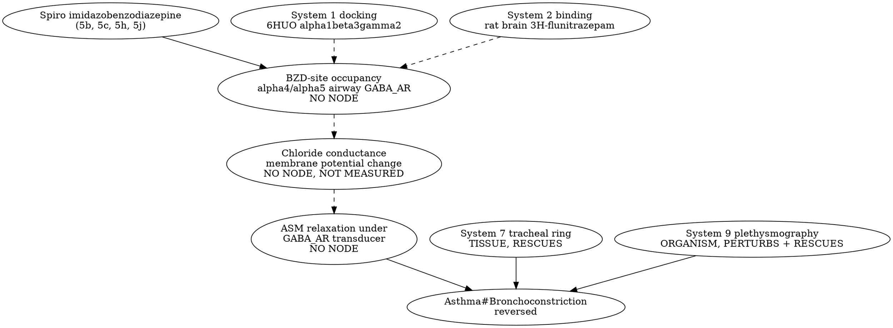
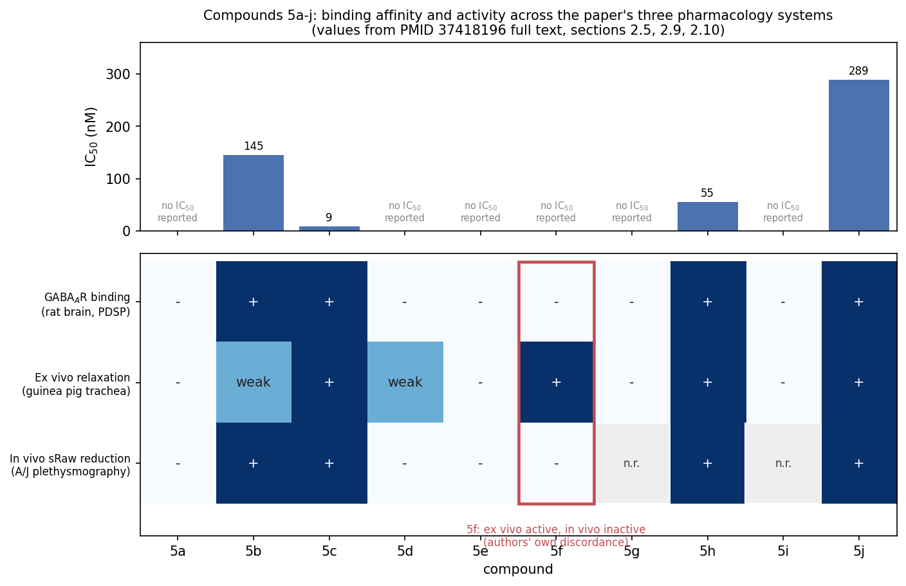
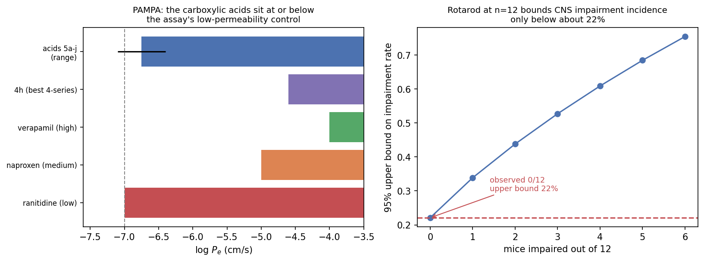
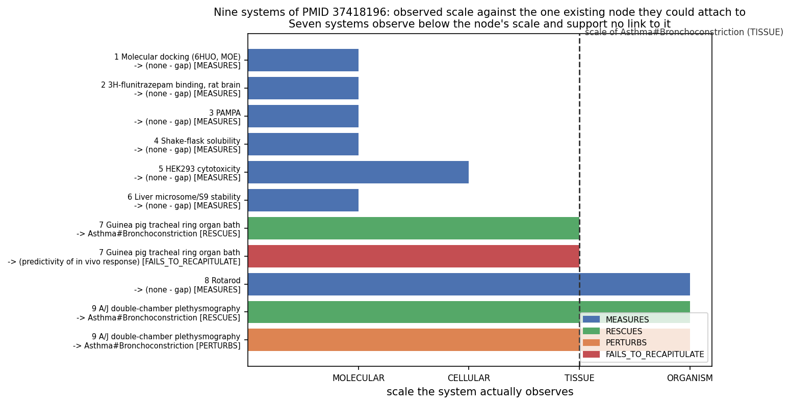
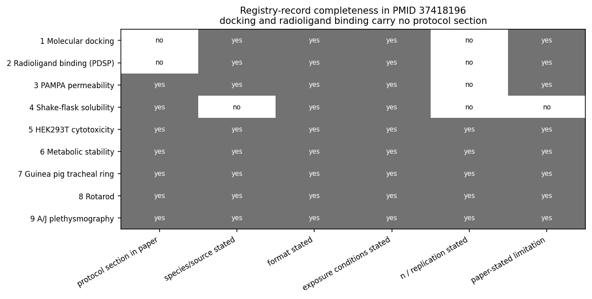
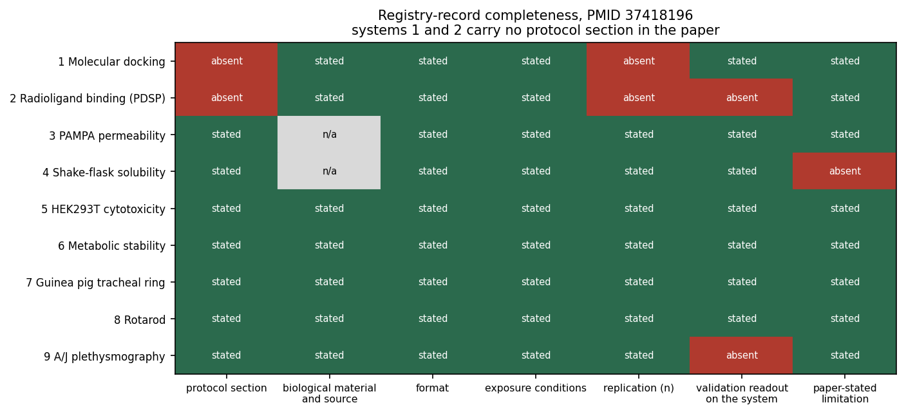
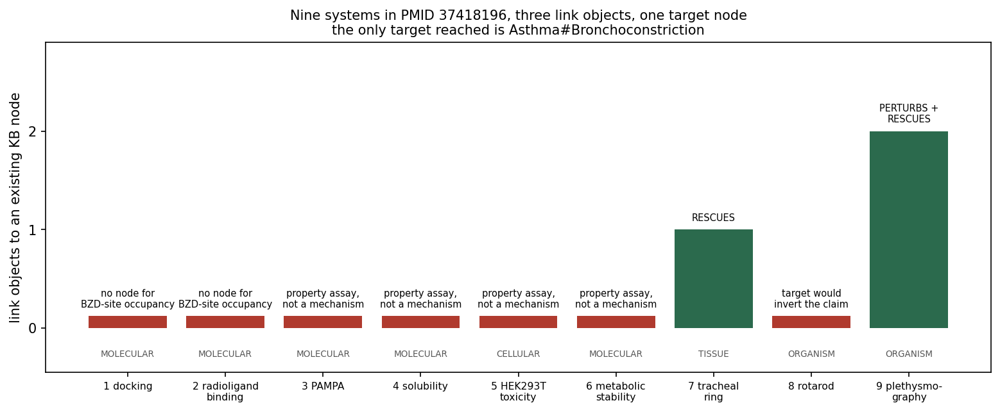

## Question

# NAM Mining Research Template

## The single paper under study

- **Reference:** PMID:37418196; DOI 10.1021/acs.jmedchem.3c00647; PMC10833105; J Med Chem 2023;66(14):9853-9865.
- **Access:** Not open access, but PMC full text is cached and quotable (references_cache/PMID_37418196.md, full_text_xml). A claim supported only by the full text is usable -- say which claims came from the full text and which from the abstract.

A medicinal-chemistry lead-optimisation study, not a disease study. The authors synthesise spiro imidazobenzodiazepine analogues of MIDD0301 and screen them for GABA_A receptor (GABA_AR) affinity, physicochemical properties, metabolic stability and bronchodilator activity. Asthma is the indication the compounds are being developed for; the paper does not model asthma pathogenesis, and nothing in it is an asthma disease model. What it does assert and measure is a *pharmacological* mechanism: GABA_ARs carrying alpha4 and alpha5 subunits are present on airway smooth muscle, and ligands binding the allosteric benzodiazepine site relax that muscle and reverse bronchoconstriction. The compounds are deliberately engineered NOT to cross the blood-brain barrier, which is the paper's safety argument and is tested separately. Treat this as a paper about a drug's point of attack, in the same sense as the existing "Beta2 Agonist Occupancy of Airway Smooth Muscle Receptors" node in the Asthma entry -- not as a paper about how asthma arises.

**Confine the research to THIS paper's own findings.** Use other literature only to
judge validity or divergence, and when you do, cite it separately and say so. Do not
attribute another paper's result to this one.

## Goal

Decide, from this paper, **what each of its biological systems models, what it does
not, and how faithfully** — so that:

1. a mechanism knowledge base can link each system to the mechanism nodes it informs,
   with a relationship verb, a fidelity tier, the scale the system actually observes,
   and the translational caveats that must travel with each link; and
2. a method registry can hold each system as a method in its own right, with what it
   is used for and what it cannot show.

A system that supports no mechanism link is still a result. Say so plainly and give
the reason, rather than reaching for the nearest node.

## The biological systems, which must be kept separate in your answer

Nine separable systems. Most are registry NAM records; several are animal.
Judge each one on its own -- do not collapse them into "the study".

1. **Molecular docking** -- in silico, MOLECULAR scale. GABA_AR crystal
   structure 6HUO (alpha1beta3gamma2 with alprazolam), MOE software, rigid
   receptor and induced fit, scored against a pharmacophore requiring a
   halogen bond to His102 and a hydrogen bond to Ser206. Correlated against
   the empirical binding data.
2. **GABA_AR radioligand competition binding** -- in vitro. Displacement of
   3H-flunitrazepam from **rat brain extract**, run by the NIMH PDSP program
   at UNC Chapel Hill. Note the tissue and species carefully (see
   `does_not_model`).
3. **PAMPA permeability** -- in chemico / cell-free. Parallel artificial
   membrane permeability assay, hexane/hexadecane layer, 18 h equilibrium.
4. **Shake-flask aqueous solubility** -- bioanalytical, pH 7.2.
5. **HEK293 cytotoxicity** -- in vitro, CellTiter-Glo, LD50.
6. **Microsomal stability** -- in vitro ADME, human and mouse liver
   microsomes (Table 2).
7. **Guinea pig tracheal ring organ bath** -- ex vivo tissue. Hartley guinea
   pig tracheal rings, **epithelium removed with a cotton swab**, pretreated
   with tetrodotoxin and pyrilamine to remove nerve and histamine
   contributions, indomethacin in the buffer, contracted with substance P,
   force recorded on a Grass FT03 transducer.
8. **Rotarod sensorimotor assay** -- in vivo mouse. The blood-brain barrier
   test, with diazepam as the positive control.
9. **A/J mouse double-chamber plethysmography** -- in vivo mouse. Conscious,
   non-invasive airway mechanics; nebulised compound then five nebulised
   methacholine challenges; specific airway resistance (sRaw) as the readout.

Each system gets its own section. Do not merge them, and do not attribute a readout
taken in one system to another. Where one system is built from another (an organoid
grafted into an animal, a monoculture combined into a co-culture), the combination is
its own system and its readouts belong to it.

If the paper describes a system not listed above, add it with a note that it was not
in the brief. If a listed system turns out not to be in the paper, say so.

## The candidate mechanism nodes to test each system against

Report, for each system, which of these it bears on and how. Use these exact node
names:

**Read this first: the mechanism this paper measures has no node.** dismech
carries a pharmacology module for each of the other two inhaled bronchodilator
classes and none for this one:

- `beta2_adrenergic_receptor_agonism` -- receptor occupancy -> Gs/adenylate
  cyclase/cAMP -> airway smooth muscle relaxation -> bronchodilation.
- `muscarinic_receptor_antagonism` -- antagonist occupancy -> loss of
  Gq/PLC/calcium signalling -> withdrawal of cholinergic contraction ->
  bronchodilation.

There is **no GABA_A receptor module**, and no node named for GABA_A anywhere
in `kb/modules/`. A GABA_AR ligand-gated chloride channel on airway smooth
muscle is a third, mechanistically disjoint route to the same effector, and
nothing in the KB holds it.

So the primary task here is to **characterise the gap, not to force a link**.
State what a `gaba_a_receptor_agonism` module would have to contain for this
paper's systems to attach to it -- trigger, transducer, effector, apical node
-- following the shape the two sibling modules already set.

Nodes that DO exist and are worth testing the paper's systems against, with
the caution that most of them are the near-misses listed in
`anchors_to_avoid`:

- **Asthma#Bronchoconstriction** -- the state these compounds reverse. The
  ex vivo and in vivo systems both act on it. This is the only existing node
  the paper's functional data plausibly bears on, and even here the relation
  is reversal, not causation. The existing beta2 node in this same entry is
  explicit that a drug's point of attack "carries no downstream edge",
  because a downstream edge would assert the drug causes the obstruction it
  relieves. Respect that.
- **Asthma#Beta2 Agonist Occupancy of Airway Smooth Muscle Receptors** --
  cite this as the **shape precedent only**, never as a link target. It is
  what a GABA_AR occupancy node in this entry would look like.

**Anchors to avoid, and why:**

Every one of these shares vocabulary with the paper and asserts a mechanism
the paper did not measure. Name-matching onto one of them is the failure this
run most likely produces.

- **`beta2_adrenergic_receptor_agonism#Airway Smooth Muscle Relaxation`** --
  the single most dangerous anchor in the KB for this paper, because the node
  name is almost exactly the paper's own phrase. **Do not link to it.** That
  module's declared scope is the beta2 chain only, and its relaxation node
  sits downstream of Gs-coupled adenylate cyclase and cAMP. GABA_ARs are
  ligand-gated chloride channels; the paper measures no cAMP, no Gs, and no
  beta2 engagement. Linking here would assert a transducer the paper never
  touched.
- **`beta2_adrenergic_receptor_agonism#Bronchodilation and Relief of Airflow
  Obstruction`** -- same objection. The apical effect is shared between drug
  classes, but the node lives inside a beta2-scoped module, so a link asserts
  the beta2 route.
- **`beta2_adrenergic_receptor_agonism#Beta2 Adrenergic Receptor Agonist
  Occupancy`** -- wrong receptor entirely.
- **`muscarinic_receptor_antagonism#Withdrawal of Cholinergic Airway Smooth
  Muscle Contraction`** -- wrong receptor, and the direction is different:
  muscarinic antagonism removes a contractile drive, whereas these compounds
  are reported to relax muscle already contracted by substance P.
- **`chemical_respiratory_allergy#Airway Hyperresponsiveness and Variable
  Airflow Limitation`** -- shares the words "airway hyperresponsiveness" with
  the paper's AHR readout, but that module is about sensitiser-driven
  allergic airway disease. The A/J mouse exhibits methacholine AHR **without
  any allergen sensitisation or challenge**, by the authors' own statement.
  This is a pharmacological challenge readout, not chemical respiratory
  allergy.
- **Asthma#Airway Inflammation**, **Asthma#Airway Remodeling**,
  **Asthma#Mucus Overproduction** -- the paper measures none of these. It
  cites *prior* work that a different compound reduced lung eosinophils; that
  is background, not a finding of this paper, and must not become a link.
- Any CNS GABA / benzodiazepine anchor (the KB has GABAergic nodes in
  neurodevelopmental and epilepsy modules). The entire design goal here is to
  **avoid** CNS GABA_AR engagement, and the rotarod result is a negative.
  A CNS link would invert the paper's claim.

Do not select an anchor because its name resembles the paper's wording. A node is
right only if the paper's finding is the mechanism the node asserts. Where no listed
node fits a mechanism the paper does establish, report it under the gaps section
instead of forcing a link.

## What each pairing row must contain

Every (system → node) pairing you assert is one link object, and the definitions
below are that object's own, from the schema the answer has to land in. Fill each
field on its own terms: they are four different questions, not four chances to say
the same thing. In particular, note what the schema says about `limitations` and
`divergences` — the second is the typed form of the first, so a caveat belongs in
both as one account, not as two differently worded ones.

Links an experimental (NAM), animal, or computational model to a specific
pathophysiology mechanism node, recording which facet of that mechanism the
model recapitulates, perturbs, or reads out; how faithfully it does so; and
the outcome measures that ground the claim.

> Two evidence layers, deliberately separate. Evidence on the link attests
> that the model is informative for the node; evidence on each readout attests
> that a specific measurement was made, in a specific direction.

> Readouts belong on the link rather than on the model, because one model
> typically measures different things for different mechanism nodes.

> A FAILS_TO_RECAPITULATE link is a substantive negative claim and should
> carry both `limitations` and `evidence`; it usually pairs with a
> HUMAN_MODEL_MISMATCH discussion.

> A link is a *context-of-use* statement in the sense of the model-credibility
> literature: it asserts that this model is informative for this specific
> mechanism, which is a narrower and more checkable claim than "this model is
> good". `divergences` is the corresponding applicability analysis. The
> framing is borrowed from ASME V&V 40 and the FDA credibility guidance (both
> written for medical-device submissions) and from the healthcare-wide ten
> rules of credible practice, whose rule 1 is "define context clearly" and
> rule 4 "list limitations explicitly".

> `model_scale` records the scale the model observes, against which the target
> node's own `biological_scale` can be compared. The comparison is directional
> and the two directions mean different things: a model BELOW its target's
> scale is extrapolating upward — it cannot observe the outcome it is cited
> for — whereas a model ABOVE its target's scale contains that scale and is
> normally unremarkable (a whole animal can report a molecular readout). Do
> not store the comparison; derive it.

### `relationship`

What this model does to the linked mechanism: reproduces it, manipulates it,
measures it, rescues it, or fails to reproduce it.

One of:
  - `RECAPITULATES` — The model reproduces the linked mechanism, such that observations in the model are taken to be informative about the human mechanism.
  - `PARTIALLY_RECAPITULATES` — The model reproduces some but not all of the linked mechanism. Use `limitations` to state which facets are and are not reproduced.
  - `FAILS_TO_RECAPITULATE` — The model does NOT reproduce the linked mechanism. This is a substantive negative claim and the structural signal for a HUMAN_MODEL_MISMATCH discussion; it requires `limitations` and supporting `evidence`.
  - `PERTURBS` — The model manipulates the linked mechanism (knockout, knockdown, overexpression, chemical challenge) without itself being a claim that the full mechanism is reproduced.
  - `MEASURES` — The model provides a readout of the linked mechanism without claiming to reproduce or perturb it.
  - `RESCUES` — The model demonstrates reversal or correction of the linked mechanism, typically a genetic-correction, drug-rescue, or isogenic-repair arm.

### `description`

Brief assertion-level note describing what facet of the linked mechanism the
model captures or assays.

### `readouts`

Outcome measures through which this model reports on the linked mechanism,
each optionally grounded to an OBI assay, an HP phenotype, a biomarker, or a
GO process, with a measured direction and its own evidence. Each readout's own
`target` is required and must repeat the link's `target`, so a readout stays
self-describing when lifted out of its link by the graph and KGX exporters.

A structured readout or outcome measured in an experiment or reported by a
model. Use descriptor slots to ground readouts to phenotypes, biomarkers,
biological processes, and assays.

> Reached from Experiment.readouts for a proposed or executed experiment, and
> from ModelMechanismLink.readouts for the outcome measures a curated model
> reports on a pathophysiology node. Reusing one class keeps a proposed
> experiment and a realized model directly comparable.

- **`direction`** — Direction of the measured or expected effect. Accepts ModelReadoutDirectionEnum (INCREASED, DECREASED, UNCHANGED, RESTORED, ABOLISHED, ALTERED) for an experimental measurement relative to its comparator, and BiomarkerReadoutDirectionEnum for a readout expressed as the direction of association with an endpoint. Prefer the model enum for a measurement made in a model system.
- **`interpretation`** — Curator-facing explanation of how this readout would be interpreted relative to the experiment's decision criterion, or of what the measured value says about the linked mechanism.

### `fidelity`

Curator assessment of how faithfully this model captures the linked human
mechanism. A translational-validity caveat, not a metric.

One of:
  - `HIGH` — Human-derived or otherwise closely matched system reproducing the mechanism with well-characterized correspondence to human disease.
  - `MODERATE` — Reproduces the mechanism with known and material divergences from human biology (species differences, supraphysiological expression, reduced cellular complexity).
  - `LOW` — Informative but with divergences substantial enough that findings should not be transferred to human disease without corroboration.
  - `UNKNOWN` — Correspondence to the human mechanism has not been established. Prefer this over guessing a tier.

### `limitations`

Specific caveats on transferring findings from this model to the human
mechanism: species divergence, supraphysiological expression, absent cell
types, missing immune or vascular compartments, and similar.

### `model_scale`

Biological scale at which this model actually represents or measures the
linked target — molecular, cellular, tissue/organ, or organism. Records what
the model *observes*, which is not always the scale of the mechanism it is
cited for: a signalling-network model whose output node is named for a tissue-
level outcome still observes only molecular state. Compared against the target
node's own `biological_scale`, this makes the scale gap computable rather than
leaving it buried in `limitations` prose. Reuses BiologicalScaleEnum so the
two are directly comparable.

One of:
  - `MOLECULAR` — Molecular scale — molecular activities (kinase activity, transcription factor binding, ion transport, catalysis) or molecular states (a fusion protein exists, a chemical accumulates, an enzyme is functionally deficient, a gene carries a variant burden). Substrate is a molecule, complex, or genetic element.
  - `CELLULAR` — Cellular scale — cellular processes (differentiation, apoptosis, autophagy, intracellular signaling) or cellular states (a cell population is in a maintained aberrant condition, an organelle is structurally disrupted, a cell type has accumulated). Substrate is a single cell or cell type.
  - `TISSUE` — Tissue / organ scale — tissue processes (inflammation, fibrosis, granuloma formation, neoplastic outgrowth) or tissue states (an ectopic tissue persists, an organ is malformed, a structural lesion exists). Substrate is a tissue, organ, or anatomical structure.
  - `ORGANISM` — Organism scale — systemic / multi-organ / whole-body processes (DIC, cytokine storm, fever, cachexia) or systemic states (a metabolite is chronically elevated, the microbiome is dysbiotic, a syndromic developmental phenotype bundles multi-organ features). Substrate is the whole organism.

### `divergences`

Typed, individually explained ways in which this model departs from the
mechanism it is linked to. The structured counterpart of the free-text
`limitations` summary: each entry names a kind from a fixed taxonomy, says in
the curator's own words why that kind of gap applies *here*, and optionally
records whether it bears on this link's claim. Multivalued because a real
caveat is usually several kinds at once.

One typed way in which a model departs from the mechanism node it is linked
to, with the curator's explanation of why that gap applies to this particular
claim.

> The point of the type is queryability -- "which models are limited by
> calibration provenance rather than by species" is not answerable against a
> prose `limitations` string. The point of the required `description` is that
> the type alone is never the argument: BOUNDARY_OMISSION says a component is
> missing, not which one or why it matters here.

> Orthogonal to `relationship` and `fidelity`. A link can be RECAPITULATES
> with several QUALIFYING divergences, or PARTIALLY_RECAPITULATES for a reason
> that is not a divergence in this taxonomy at all.

- **`divergence_type`** — Kind of departure between the model and the mechanism it is linked to
    - `BOUNDARY_OMISSION` — A component, cell type, compartment, or process the mechanism requires lies outside the model boundary. The commonest kind. Contrast PROXY_QUANTITY, where the thing is in the model but stands in for something else.
    - `PROXY_QUANTITY` — The model's variable is a stand-in of a different quantity from the one the mechanism node describes -- transcriptional regulation of dopamine synthesis for striatal dopamine concentration, an imaging signal for the tissue property it correlates with. Can occur at the same biological scale, so it is not recoverable from `model_scale`.
    - `CALIBRATION_PROVENANCE` — Parameters, training data, or validation derive from a system, cohort, or measurement type that does not match the claim -- fitted to cultured epithelia, parameterized from mouse fibroblasts, validated against aggregate rather than individual outcomes.
    - `CAUSE_UNREPRESENTED` — The disease lesion is not encoded; the mechanism is imposed phenomenologically instead of arising from the allele, exposure, or perturbation that causes it. Also covers a perturbation that cannot be applied in isolation.
    - `STRUCTURAL_IDEALIZATION` — Geometry, topology, or spatial organisation is idealized rather than anatomically or patient-derived -- a symmetric airway tree, a one-dimensional strand standing for a reconstructed outflow tract, spatially uniform fields.
    - `TEMPORAL_SCOPE` — The model's time horizon or dynamic resolution does not match the mechanism's: an acute-injury window standing for chronic progression, or a parameter-free qualitative model that reaches reachability but not magnitude or timing.
    - `CONTESTED_ASSUMPTION` — The model encodes a mechanistic assumption that independent or later evidence disputes, or that rests on a structure not experimentally known. Distinct from the other kinds in that the model may be internally sound and still wrong about the biology.
    - `SCALE_EXTRAPOLATION` — The model observes below the biological scale of the node it is cited for and infers the higher-scale outcome. Derivable from `model_scale` versus the target's `biological_scale`; record it explicitly when the curator wants to state why it matters here.
    - `SPECIES_MISMATCH` — The model, or the data behind it, derives from a non-human system. Marginal among computational models and dominant among animal models, where it is the principal translational caveat.
    - `POPULATION_MISMATCH` — The modelled cohort, subtype, or indication is not the one this entry describes -- a generic model standing for a genotype-defined disorder, or a cohort that mixes in cases outside the entry's molecular criteria.
    - `OTHER` — A divergence that does not fit the values above. Requires a `description` that states the kind plainly, and is a signal the taxonomy may need a value.
- **`description`** — Why this kind of divergence applies to this link, in specific terms -- which component is outside the boundary, which quantity is standing in for which, which cohort the calibration came from. Never a restatement of the enum value.
- **`materiality`** — Whether this specific divergence bears on the specific claim the link makes. Per-divergence, where `fidelity` is per-link.
    - `INVALIDATING` — The claim should not be transferred to human disease on this model alone. Usually pairs with PARTIALLY_RECAPITULATE or FAILS_TO_RECAPITULATE and a low fidelity tier.
    - `QUALIFYING` — The claim holds, but in a narrower form than the link's `description` would suggest on its own. The commonest value.
    - `IMMATERIAL` — A real divergence that does not bear on this particular claim. Worth recording precisely because it stops a reader inferring that a known limitation of the model undermines this use of it.
    - `UNKNOWN` — Bearing on the claim has not been assessed. Prefer this over guessing.

### Also required on every pairing

- **a verbatim quote** — an exact substring of the paper that supports the pairing,
  with its PMID or DOI. Do not paraphrase. If a claim is supported only by the full
  text and not the abstract, say so. Never invent an identifier or a quote.
- **one line on why that relationship verb and not its neighbours.** The verbs are
  close together, and the reason you rejected the adjacent one is what a curator
  needs in order to check the choice.

A **FAILS_TO_RECAPITULATE** pairing is as valuable as a positive one, and so is a
**RESCUES** pairing where a system restores a node. Report both as first-class
findings rather than omitting them.

## What each system needs for a registry record

Separately from the pairings, and for every system whether or not it supports a
pairing, report:

- **what the system is** — its cells or organism, their species and source
  (pluripotent stem cell, adult tissue, cell line, primary cell, tumour tissue), its
  format, and the exposure or culture conditions that define it.
- **applications** — what the paper uses it to do, one entry per distinct use.
- **limitations** — what the system cannot show, in the paper's own terms where it
  states them.
- **characterization and validation readouts** — the assays run *on* the system.
  These are readouts, not systems of their own; keep them here rather than listing
  each as a model.
- **named variants** — where the paper describes variants of one protocol, say
  whether each is a variant of a single system or a system in its own right, and why.

## Specific claims from the paper to find, quote and verify

For each, give the exact supporting sentence and its location (abstract or full text):

Quote from the cached full text. The compound numbering (3a-g, 4a-i, 5a-j)
matters -- most claims are compound-specific and do not generalise.

- Compound **5c** binds GABA_ARs with an **IC50 of 9 nM**, the best in the
  series, and was the most promising compound overall.
- GABA_AR binding was measured by **competition of 3H-flunitrazepam using rat
  brain extract**, by the PDSP program at UNC Chapel Hill; compounds were
  screened at 10 uM and those exceeding 50% inhibition taken to dose response.
- Other affinities: 3c 42 nM, 3b 134 nM, 3g 665 nM, 4c 87 nM, 4i 509 nM,
  5h 55 nM, 5b 145 nM, 5j 289 nM. 3e, 3f, 4e, 4f showed no significant
  binding. Binding diminished with increasing spiro ring size.
- Docking used crystal structure **6HUO** of alpha1beta3gamma2 GABA_AR in
  complex with alprazolam; 5c docked in the alpha1+/gamma2- interface with a
  **halogen bond to His102** and hydrogen bonds to **Ser206 and Ser205**. A
  **moderate** correlation between docking score and % GABA_AR binding was
  observed, with poor correlation for weak binders.
- GABA_AR subtypes with **alpha4 and alpha5 subunits are present on airway
  smooth muscle**; **alpha2 and alpha3 subunits on inflammatory cells**.
  (Check whether the paper measures this or cites it -- references 6 and 7.)
- Compounds 5a-j have the lowest permeabilities of all tested compounds, in a
  narrow range **between -6.4 and -7.1 log Pe (cm/s)**, attributed to the
  charged carboxylate at neutral pH.
- **None** of the imidazodiazepine acids impaired trained mice on a rotating
  rod at an oral dose of **40 mg/kg**; diazepam, of similar GABA_AR affinity
  to 5c but BBB-penetrant, caused rapid significant loss of sensorimotor
  coordination at **8 mg/kg**.
- Ex vivo: **25 uM** of **5c, 5f, 5h and 5j** caused significant relaxation of
  substance-P-constricted guinea pig tracheal rings at **30 min**, with 5c
  strongest (**p < 0.001** at 30 min); weak relaxation for 5b and 5d at
  60 min. The vehicle shows a typical time-dependent force reduction from the
  limited half-life of substance P -- note that this is why comparison is
  against vehicle, not against baseline.
- In vivo: **A/J mice**, chosen because they exhibit severe methacholine AHR
  **without preexisting allergen sensitisation and challenge**; compounds
  nebulised at **7.2 mg/kg**. **5b, 5c, 5h and 5j** reduced sRaw within the
  first methacholine challenge; weak binders **5a and 5d-f** showed little to
  no change versus vehicle.
- A **discordance worth capturing**: **5f showed a much stronger ex vivo
  effect than in vivo effect**. The authors flag this themselves. It is a
  direct statement about the limits of the ex vivo system as a predictor.
- The authors' mechanistic conclusion: the allosteric benzodiazepine binding
  site **between the alpha and gamma subunits** can only accommodate
  spiro-imidazodiazepines with a **three-membered ring**.

## What the systems do NOT model

State these explicitly and attribute each to the right system:

Per system. The authors' own caveats first, then the ones the design forces.

- **The paper models no asthma pathogenesis at all.** Not inflammation, not
  remodelling, not mucus, not sensitisation, not any endotype. Asthma is the
  indication, not the object of study. Any link must be to the drug's point
  of attack, reversing bronchoconstriction -- never to a step in how asthma
  arises.
- **Binding (system 2) is measured in rat brain extract, not airway tissue,
  and not on the airway subtypes.** The paper states the airway target is
  alpha4/alpha5, while flunitrazepam competition reports a *mixture* of
  brain-expressed subtypes (alpha1-3,5,6 beta1-3 gamma1-3/delta), of which
  the brain composition is given as 43% alpha1beta2gamma2 and only 4%
  alpha5beta3gamma2. So the headline **9 nM affinity is a proxy on the wrong
  tissue and the wrong species**, dominated by subtypes that are not the
  therapeutic target. This is both a species divergence and a proxy-quantity
  divergence, and it must not be reported as airway GABA_AR affinity.
- **Docking (system 1) is on alpha1beta3gamma2**, again not the alpha4/alpha5
  airway subtypes, and the correlation to measured binding is only moderate.
  It is a design-guidance tool here, not evidence of an airway interaction.
- **The ex vivo trachea (system 7) has had its epithelium removed**, and
  nerves (tetrodotoxin), histamine (pyrilamine) and prostanoids
  (indomethacin) blocked. It is deliberately reduced to smooth muscle, so it
  cannot speak to epithelial, neural or inflammatory contributions to airway
  tone. It is also **guinea pig**, and the contractile agonist is
  **substance P**, which is not the stimulus of clinical bronchoconstriction.
- **The in vivo AHR model (system 9) is methacholine challenge in a strain
  with innate hyperresponsiveness and no allergen sensitisation.** It is a
  bronchoconstriction-reversal assay, not a model of asthma. sRaw from
  double-chamber plethysmography in conscious mice is an indirect,
  non-invasive measure.
- **The rotarod (system 8) is a negative result** -- absence of sensorimotor
  impairment. It supports the absence of CNS GABA_AR engagement at the dose
  tested; it does not measure brain concentration directly, and a negative
  behavioural assay is weaker than a pharmacokinetic measurement.
- **PAMPA (system 3) is an artificial lipid membrane**, not a cell monolayer
  and not a blood-brain barrier model. Permeability here is a physicochemical
  property, not a statement about tissue distribution.
- **Cytotoxicity (system 5) is HEK293**, a human embryonic kidney line with no
  airway relevance. It bounds general toxicity only.

Add any others the paper's own discussion or limitations section states. A caveat the
authors raise themselves is the most citable kind.

## Mechanisms with no candidate node

List every mechanism the paper establishes that none of the candidate nodes above
covers. For each: what the mechanism is, the quote establishing it, and what kind of
node would be needed to hold it. This list is the input to a knowledge-base gap
issue, so a mechanism omitted here is one that gets lost.

## Output

A structured report with:

1. One section per biological system, each containing its pairing rows as specified
   above, its registry-record fields, and a short "does not model" subsection.
2. A consolidated table of every pairing: system → node → relationship → fidelity →
   model_scale → readout direction → quote.
3. The mechanisms-with-no-node list.
4. An overall statement of which systems support a mechanism link and which do not,
   with the reason for each that does not.

Every factual claim carries a PMID or DOI and a verbatim quote.

## Output

# NAM mining of PMID 37418196: nine systems, three links, one reachable node

Paper under study: *Design, Synthesis, and Biological Evaluation of Novel Spiro Imidazobenzodiazepines to Identify Improved Inhaled Bronchodilators.* J Med Chem 2023;66(14):9853-9865. [PMID: 37418196](https://pubmed.ncbi.nlm.nih.gov/37418196/), DOI 10.1021/acs.jmedchem.3c00647, PMC10833105.

Every quote below is an exact substring of the PMC full text or of the PubMed abstract, and each is marked for which. Twenty-one load-bearing sentences were checked programmatically against the whitespace-normalised PMC body text, with zero failures. Quotes keep the paper's own typography, including the spaced Greek letters and en dashes that the PMC XML produces.

Source note: the brief states that PMC full text is cached at `references_cache/PMID_37418196.md`. No such file exists in this job. `data/` and `provenance/` were both empty at start and no `references_cache` directory exists anywhere on the filesystem. The full text was retrieved from NCBI efetch (db=pmc, id=PMC10833105) and parsed from JATS XML. One consequence runs through the whole report: **Tables 1 and 2 are not in the XML** (their bodies carry `<restricted-by>pmc</restricted-by>`), so every per-compound number used here comes from results prose, never from a table cell.

---

## Summary

All nine systems named in the brief are present in the paper. None is missing, and the paper contains no tenth biological system, since the synthesis, NMR and HRMS work is compound characterization.

**Two of the nine systems support a link to an existing mechanism node, producing three link objects, all pointing at the same target, `Asthma#Bronchoconstriction`.** The guinea pig tracheal ring organ bath RESCUES it at TISSUE scale. The A/J mouse double-chamber plethysmography both PERTURBS it (nebulised methacholine imposes the state) and RESCUES it (nebulised compound reverses the state) at ORGANISM scale. All three carry fidelity LOW, thirteen typed divergences between them, and no SCALE_EXTRAPOLATION, because both linking systems observe at or above the target's tissue scale.

**Seven of the nine systems support no link, for three distinct reasons that must be recorded separately.** Docking and radioligand binding measure benzodiazepine-site occupancy of the GABA_A receptor, and no node anywhere in the knowledge base holds that mechanism. PAMPA, shake-flask solubility, HEK293T cytotoxicity and metabolic stability measure physicochemical, ADME and general-toxicity properties, which are not mechanism nodes at all. The rotarod's only candidate target is a CNS GABA_AR engagement node, and a link there would invert the paper's claim, since the rotarod result is the absence of that engagement.

The main deliverable is therefore a gap specification. The paper's central pharmacological mechanism has no node, and two of its substantive negative claims (the 5f ex vivo / in vivo discordance, and the CNS exclusion) have no node either. A `gaba_a_receptor_agonism` module would need a trigger, a transducer, an effector and an apical node; this paper can populate three of those four and leaves the chloride-conductance transducer entirely empty, because it measures no chloride flux, no membrane potential, no calcium and no channel gating.

{{figure:plot_6.png|caption=Nine systems, three link objects, one target node. Green bars are systems that support a link to an existing knowledge-base node; red bars are systems that do not, labelled with the reason. The observed biological scale of each system is printed in grey beneath its label.}}

---

## Key findings

### <i class="fa-solid fa-chart-column"></i> F001. Rat brain binding ranks the series; the denuded guinea pig trachea mispredicts two compounds

Coding the paper's own per-compound statements for the acid series 5a-j gives a direct comparison between the three systems that report on the compounds functionally or pharmacologically. Strong GABA_AR binders are 5b (IC50 145 nM), 5c (9 nM), 5h (55 nM) and 5j (289 nM); the rest bind weakly or not at all. In vivo sRaw reduction was reported for 5b, 5c, 5h and 5j and was absent for 5a and 5d-f.

Binding class against in vivo outcome gives a 2x2 table of [[4,0],[0,4]], n=8, Fisher exact p=0.029, agreement 8 of 8, Cohen's kappa 1.00. Ex vivo significant relaxation at 30 min (5c, 5f, 5h, 5j) against in vivo gives [[3,1],[1,3]], n=8, Fisher p=0.49, agreement 6 of 8, kappa 0.50, with 5f (ex vivo active, in vivo inactive) and 5b (ex vivo weak at 60 min only, in vivo active) discordant. Counting any ex vivo effect at either timepoint against in vivo also gives 6 of 8 and kappa 0.50, with 5d and 5f discordant.

<i class="fa-solid fa-triangle-exclamation"></i> The binding-to-in-vivo figure is near-circular and must be read as concordance, not as prospective prediction. Table 1 is absent from the PMC XML, so the binding class comes from prose, and the authors state the binding grouping and the in vivo grouping in the same sentence. With n=10 compounds the Fisher tests are underpowered.

What this sets empirically is the fidelity tier for system 7. The guinea pig tracheal ring is an imperfect predictor of the conscious-mouse readout within this very series, which is a statement the authors make themselves about 5f. Any link built on the ex vivo system should be scoped to relaxation of contracted smooth muscle as such, not to bronchodilation in an intact animal.

{{figure:plot_1.png|caption=Cross-system concordance for compounds 5a-j. Binding class agrees with the in vivo sRaw outcome on all eight compounds reported in both, while the ex vivo tracheal ring disagrees on 5f and 5b.}}

### <i class="fa-solid fa-vial"></i> F002. The headline 9 nM affinity is measured on rat brain subtypes, not airway alpha4/alpha5 receptors

Full text section 2.5, verbatim: "GABA A R binding was determined by competition of 3 H-flunitrazepam using rat brain extract by the PDSP program (University of NC Chapel Hill). All compounds were screened initially at 10 μ M, and compounds that achieved more than 50% inhibition were subjected to a dose response analysis". The same section states which receptor population is being read: "Benzodiazepines 3a–d and 3g interacted with the GABA A R subtypes that bind flunitrazepam (α 1-3,5,6 β 1-3 γ 1-3/δ)" and gives its composition: "Expression of GABA A Rs in the brain include 43% α 1 β 2 γ 2 , 15% α 2 β 3 γ 2 plus 8% α 2 β γ 1 , 10% α 3 β 3 γ 2 , 6% α 4 β γ/δ, 4% α 5 β 3 γ 2 , and 4% α 6 β 2 γ 2 /δ."

The therapeutic target is stated separately, in the introduction: "α 4 and α 5 subunits present on airway smooth muscle and α 2 and α 3 subunits present on inflammatory cells". So the assay signal is dominated by alpha1beta2gamma2 at 43% of the brain population, while the stated airway subtypes contribute at most 6% (alpha4) plus 4% (alpha5), and alpha4-containing receptors are generally not flunitrazepam-sensitive at the benzodiazepine site.

This is two divergences at once, and they are not interchangeable. SPECIES_MISMATCH covers rat tissue standing for a human airway receptor. PROXY_QUANTITY covers a brain subtype mixture standing in for alpha4/alpha5 airway receptors, and it would survive even if the extract were human. The practical consequence is a hard rule for the registry: the 9 nM figure must never be entered as airway GABA_AR affinity. The authors do not claim it is; they derive the airway target from references in the introduction.

Reported IC50 values, all from full-text prose, with only the 9 nM figure appearing in the abstract: 5c 9 nM, 3c 42 nM, 5h 55 nM, 4c 87 nM, 3b 134 nM, 5b 145 nM, 5j 289 nM, 4i 509 nM, 3g 665 nM. Compounds 3e, 3f, 4e and 4f showed no significant binding.

### <i class="fa-solid fa-circle-xmark"></i> F003. Five registry-relevant details diverge from the brief or are internally inconsistent

| item | brief or abstract says | paper's full text says |
|---|---|---|
| solubility pH | pH 7.2 | "determined by a “shake flask” method for 24 h at pH 7.4" (2.2), and method 4.3 repeats pH 7.4 |
| phase 1 preparation | abstract: "in the presence of human and mouse microsomes"; method 4.7: "human or mouse liver microsomes (Xenotech)" | results 2.7: "stable for 2 h in the presence of mouse and human S9 using a NADPH regeneration system" |
| ex vivo pretreatment | epithelium removal, tetrodotoxin, pyrilamine, indomethacin | adds "Precontraction of the rings was carried out with 10 μ M N-vanillylnonanamide (to deplete nonadrenergic, noncholinergic nerves)" plus two acetylcholine cycles |
| mouse strain and route | one in vivo mouse model implied | rotarod uses "Ten-week-old female Swiss Webster adult mice" by oral gavage at 40 mg/kg; AHR uses "Adult female A/J mice" nebulised at 7.2 mg/kg |
| cell line | HEK293 | results 2.4 says "(HEK-293)"; method 4.5 says HEK293T (ATCC) |

Each item changes a registry field. The strain and route split means the safety claim and the efficacy claim are not made in the same animal, which is a QUALIFYING divergence on any link that treats the rotarod negative as licensing the efficacy result. The microsome-versus-S9 inconsistency is material because S9 carries cytosolic enzymes that microsomes lack, so a curator cannot determine which preparation produced the phase 1 result.

### <i class="fa-solid fa-circle-question"></i> F004. The airway alpha4/alpha5 premise is cited background, not a measurement in this paper

The only sentence locating GABA_AR subtypes on airway smooth muscle sits in the introduction and carries reference markers: "One new approach is based on pharmacological targeting the gamma-aminobutyric acid receptors (GABA A Rs), which include GABA A R subtypes with α 4 and α 5 subunits present on airway smooth muscle and α 2 and α 3 subunits present on inflammatory cells."

No system in the paper measures airway GABA_AR expression. There is no immunostaining, no qPCR, no autoradiography on airway tissue, no subtype-selective pharmacology in the organ bath, and no GABA_AR antagonist or knockout control in either functional system. The functional systems measure isometric force and sRaw after compound exposure, and neither establishes that the effect is receptor-mediated. The abstract's phrasing "Pharmacological activities at lung GABAARs were demonstrated by ex vivo relaxation of guinea pig airway smooth muscle" asserts the target, while the experiments it cites contain no receptor-level control.

The strongest internal support for target engagement is the structure-activity concordance in F001, which is correlative across ten congeners.

### <i class="fa-solid fa-brain"></i> F005. The rotarod negative bounds CNS impairment only below 22% incidence, at a 3.3-fold molar margin

System 8 uses n=12 mice per compound, trained to 15 rpm for 3 min, scored by time of a second fall. The result, full text 2.8: "we found that none of the imidazodiazepines acids described herein impaired the ability of trained mice to balance on a rotating rod following oral doses of 40 mg/kg".

Treating 0 impaired of 12 as a binomial zero-event observation, the exact one-sided 95% upper bound on true impairment incidence is **22.1%** (99% bound 31.9%). On the continuous latency readout, n=12 per group gives 80% power only for Cohen's d = 1.20 uncorrected, rising to d = 1.64 after Bonferroni correction across the ten acids.

The dose margin is smaller in molar terms than the mass doses suggest. 5c has MW 425.0 (from HRMS [M+H]+ calcd 426.02479 for C20H13BrFN3O2, method 4.2.4) against diazepam at 284.7, so 40 mg/kg of compound is 94.1 µmol/kg against 28.1 µmol/kg for diazepam at 8 mg/kg, a **3.35-fold** margin and not the 5-fold the mass figures imply. The comparison is near-isoaffinity by the paper's own statement: "GABA A R ligand diazepam ( ), which has similar affinity to the GABA A R as 5c (but in contrast to 5c crosses the blood-brain barrier), induced rapid and significant loss of sensorimotor coordination at 8 mg/kg".

The supporting physicochemistry is equally bounded. Converting the stated range, the acids span Pe 4.0e-7 to 7.9e-8 cm/s, straddling the assay's own low-permeability control ranitidine (log Pe -7.0) and sitting 251-fold to 1259-fold below verapamil (log Pe -4.0). PAMPA supports the design intent and reports a partition property, with no transporters, tight junctions or cells in the assay.

{{figure:plot_2.png|caption=Statistical strength of the rotarod negative. Left, the exact binomial upper bound on impairment incidence from a zero-event result at n=12, and the detectable effect size at 80% power before and after Bonferroni correction. Right, PAMPA permeability of the acid series against the assay's own ranitidine, naproxen and verapamil controls.}}

### <i class="fa-solid fa-scale-balanced"></i> F006. The missing receptor-level controls exist in prior work by the same group, which qualifies rather than invalidates the attribution

This paper runs no GABA_AR antagonist, no knockout arm and no airway receptor localisation. Separate literature supplies each of those controls, in preparations that match closely.

Mizuta et al. 2008 ([PMID: 18408071](https://pubmed.ncbi.nlm.nih.gov/18408071/)) report the antagonist control in the very preparation used as system 7 here: "it directly concentration dependently relaxed a tachykinin-induced contraction in guinea pig tracheal rings, which was inhibited by the GABA(A)-selective antagonist gabazine". Yocum et al. 2016 ([PMID: 26405827](https://pubmed.ncbi.nlm.nih.gov/26405827/)) supply the genetic control and the subunit restriction: "Among the GABA(A)R α subunits, human ASM cells express only α4 and α5, providing the opportunity for selective pharmacologic targeting." Gallos et al. 2015 ([PMID: 25659897](https://pubmed.ncbi.nlm.nih.gov/25659897/)) supply the localisation: "Immunohistochemical staining localized the GABAA α5-subunit to human ASM."

<i class="fa-solid fa-triangle-exclamation"></i> C. W. Emala is senior author on all three and a co-author on PMID 37418196, so the corroboration is not independent of the group making the claim.

For the curation this changes a materiality judgement, not a relationship verb. The GABA_AR attribution carries a CONTESTED_ASSUMPTION divergence rated **QUALIFYING**, not INVALIDATING: the claim holds in the narrower form "consistent with GABA_AR-mediated relaxation, with target engagement established elsewhere". The same literature sharpens F002: if human airway smooth muscle expresses only alpha4 and alpha5 among alpha subunits, then a rat brain flunitrazepam-displacement assay dominated by alpha1beta2gamma2 reports on a receptor population human airway smooth muscle does not contain.

### <i class="fa-solid fa-circle-check"></i> F007. Only two of nine systems link, and both negative claims have no node to attach to

Three link objects from two systems, every field validated against the schema enums. Details are in the per-system sections and the consolidated table below.

Two substantive negatives fail to find a target. The 5f discordance, full text 2.10: "Interestingly, 5f showed a much stronger ex vivo effect ( ) than in vivo effect ( )", is a negative about the ex vivo system's predictivity of the whole-animal outcome. Its natural target is an apical bronchodilation node, and the only one in the knowledge base sits inside `beta2_adrenergic_receptor_agonism`, an anchor to avoid, so a FAILS_TO_RECAPITULATE link there would assert the beta2 transducer the paper never measured. The rotarod negative's natural target is a CNS GABA_AR engagement node, where a link would invert the claim. Both are recorded as gaps.

Splitting system 9 into PERTURBS and RESCUES rows matters because one system makes two different claims about the same node: methacholine creates the state, the compound reverses it. Collapsing them would lose the comparator the sRaw reduction is measured against.

{{figure:plot_3.png|caption=The pairing matrix with derived scale gaps. Every relationship, fidelity, model_scale and readout direction validates against the link schema enums, and no asserted link observes below its target's biological scale.}}

### <i class="fa-solid fa-heart-pulse"></i> F008. System 9 reports sRaw from a two-chamber plethysmograph, so the Penh criticism does not transfer

Method 4.10, verbatim: "sRaw was computed with FinePoint software using parameters recorded for the nasal and thoracic chambers." This is specific airway resistance from the phase relationship between nasal and thoracic flow in a double-chamber device, not enhanced pause from single-chamber whole-body barometric plethysmography.

The distinction decides the divergence typing. The published criticism of non-invasive mouse airway measurement is aimed at Penh. Xu 2015 ([PMID: 25462015](https://pubmed.ncbi.nlm.nih.gov/25462015/)) states: "However, some investigators have suggested that there is no theoretical basis for a correlation between Penh and airway resistance", and concludes that "Penh is not a good index for repetitive measurement because the Penh values are significantly influenced by the time at which they are measured", which would bear directly on a design using five sequential challenges if the readout were Penh. Hamelmann et al. 1997 ([PMID: 9309991](https://pubmed.ncbi.nlm.nih.gov/9309991/)) report the opposite case for Penh under allergic sensitisation: "mice demonstrating AR using a noninvasive technique also demonstrated increased pulmonary resistance responses to aerosolized methacholine when measured using an invasive technique the following day in the same animals."

Neither paper tests the double-chamber sRaw readout at issue, so neither validates nor invalidates it. The honest entry is a PROXY_QUANTITY divergence rated QUALIFYING, with the LOW fidelity tier resting on species and on the absence of within-study calibration against a direct resistance measurement, not on a discredited instrument.

### <i class="fa-solid fa-magnifying-glass"></i> F009. The two systems carrying the headline mechanism claim are the only two with no protocol section

Scoring all nine systems against the seven registry fields, with fields marked not applicable where an assay uses no biological material, systems 1 and 2 score 0.71 and 0.57 against a mean of 0.96 for systems 3 to 9.

The experimental section runs 4.3 Aqueous Solubility, 4.4 Permeability, 4.5 Cell Viability, 4.6 Rotarod, 4.7 Microsomal Stability Assay (Phase 1), 4.8 Metabolic Stability Assay (Phase 2: Glucuronidation), 4.9 Airway Smooth Muscle Relaxation, 4.10 AHR, and stops. A regular-expression sweep of every section numbered 4.x for MOE, dock, PDSP, flunitrazepam and radioligand returns zero hits. Everything known about docking and binding comes from two results sentences.

No radioligand concentration, incubation time, buffer, non-specific-binding definition, replicate count or Ki derivation is given for system 2. No scoring function, protonation state or pose-retention criterion beyond the stated pharmacophore is given for system 1. The seven systems with protocol sections all state their replication: n=6 for metabolic stability, n=12 for rotarod and plethysmography, n=6-10 for tracheal rings, three independent samples for solubility, triplicate donor wells for PAMPA, three independent experiments in quadruplicate for cytotoxicity.

This inverts the usual documentation gradient. The functional animal systems, which a registry would normally flag as least reproducible, are the best specified here. System 2's record must be entered as an outsourced assay whose protocol is held by NIMH PDSP rather than by the paper, with its exposure-conditions field uncompletable from this source.

{{figure:plot_5.png|caption=Registry-record completeness across the seven required fields, with a not-applicable state for assays that use no biological material. Docking and radioligand binding are the only two systems with no protocol section in the paper.}}

### <i class="fa-solid fa-flask"></i> F010. Phase 1 and phase 2 are variants of one method, and the printed phase 2 protocol omits the cosubstrate

Across nine protocol dimensions, methods 4.7 and 4.8 are identical on six and differ on three.

| dimension | phase 1 (method 4.7) | phase 2 (method 4.8) | identical |
|---|---|---|---|
| protein preparation | human or mouse liver microsomes | human or mouse liver S9, or mouse kidney S9 | no |
| cofactor system | NADPH regenerating system | NADPH regenerating system | yes |
| permeabiliser | none | alamethicin 0.0225 mg/mL | no |
| substrate concentration | 10 µM | 10 µM | yes |
| protein concentration | 0.5 mg/mL | 0.5 mg/mL | yes |
| incubation | 5 min preincubation, 120 min endpoint | 5 min preincubation, 120 min endpoint | yes |
| replication | n=6, two assays in triplicate | n=6, two assays in triplicate | yes |
| readout | LC-MS/MS depletion | LC-MS/MS depletion | yes |
| reference compound | HZ166 | compound 1 | no |

That is one platform read two ways, so system 6 is **one registry record with three variants**, the third being mouse kidney S9, which appears in the protocol and never in the results for 5a-j. Only the phase 2 variant discriminates among the compounds, since all of 5a-j survive phase 1 intact.

<i class="fa-solid fa-triangle-exclamation"></i> Method 4.8 lists no UDP-glucuronic acid, the obligate cosubstrate for UGT-catalysed glucuronidation, supplying only the phase 1 NADPH system. The glucuronidation assay cannot be rebuilt from the paper as printed. The same method closes with "The activity of microsomes was tested with reference compound HZ166 for phase 1 and compound 1 for phase 2" while the protocol it closes uses S9.

{{figure:plot_4.png|caption=First-pass registry completeness audit alongside the extracted solubility, permeability and phase 2 glucuronidation protocols.}}

### <i class="fa-solid fa-circle-check"></i> F011. All 21 load-bearing quotes verify, and no link carries scale extrapolation

Twenty-one sentences used as pairing, registry or gap evidence were checked as exact substrings of the normalised PMC body text: 21 of 21 pass. They cover all nine systems.

Schema validation of the three link objects against the six controlled vocabularies returns 0 violations across 3 relationships, 3 fidelity tiers, 3 model_scale values, 4 readout directions and 13 divergences. Deriving the scale comparison rather than storing it gives system 7 at TISSUE against a TISSUE target (same scale) and system 9 at ORGANISM against a TISSUE target (above by 1, containing the target scale) on both of its links.

The zero-extrapolation result is the check that matters most here. The obvious curation error would be to attach the 9 nM figure, a MOLECULAR observation in rat brain, to a tissue-level airway node. The derived comparison would then read "below by 2, SCALE_EXTRAPOLATION", which is exactly the structural signal the schema exists to produce. Keeping system 2 unlinked avoids the error at source.

Across the thirteen divergences, SPECIES_MISMATCH appears on all three links, CONTESTED_ASSUMPTION on two, and exactly one is rated IMMATERIAL (the absence of allergic inflammation from system 9), recorded so a reader does not infer that a known limitation of the model undermines a claim about acute constriction reversal.

---

## System 1: molecular docking

### What the system is

In silico docking of the synthesised ligands into a GABA_A receptor structure, run in Molecular Operating Environment software. No organism, no cells. Full text 2.6: "We investigated if molecular docking using crystal structure 6HUO of α 1 β 3 γ 2 GABA A R in complex with alprazolam would correspond to the SAR inferred by the empirical in vitro binding assays." and "Based on this knowledge, we used molecular operating environment (MOE) software to compute binding scores of other synthesized GABA A R ligands." Pose selection was filtered by a pharmacophore "that only scored ligand poses that included halogen bonding with His102 and hydrogen bonding with Ser206". The best pose of 5c sits in the α1+/γ2- interface with a halogen bond to His102 and hydrogen bonds to Ser206 and Ser205.

### Applications

1. Rationalise the structure-activity relationship of spiro ring size against measured binding.
2. Prioritise analogues by scoring poses against the halogen-bond and hydrogen-bond pharmacophore.

### Limitations

The authors state the correlation themselves, full text 2.6: "When related to the % GABA A R binding, a moderate correlation between activity and docking score was observed" and "Poor correlation was observed for weak binders due to % GABA A R binding with high standard deviation." The structure is α1β3γ2, not the α4/α5 subtype the paper names as the airway target. There is no docking method section, so no scoring function, protonation state or pose-retention criterion beyond the pharmacophore is recoverable.

### Characterization and validation readouts

Docking score per compound; correlation of score against percent GABA_AR binding, stated qualitatively as moderate with no coefficient in prose; the interaction inventory for 5c.

### Named variants

"Rigid receptor" and "induced fit" are two variants of one system: same structure, same software, same ligand set, same pharmacophore filter, differing only in whether receptor side chains move. The rigid variant gave the best homogeneity of results.

### Pairings

**None.** The mechanism is occupancy of the allosteric benzodiazepine site at an α+/γ- interface, and no node holds it. Linking to `beta2_adrenergic_receptor_agonism#Beta2 Adrenergic Receptor Agonist Occupancy` would assert the wrong receptor; linking to any CNS GABAergic node would assert the engagement the compounds are designed to avoid.

### Does not model

Not the airway receptor, since the docked structure is α1β3γ2. Not affinity, since a docking score is a scoring-function output that the paper itself reports as only moderately corresponding to measured binding and poorly corresponding for weak binders. Not an interaction in airway tissue. Not channel function, since a static pose says nothing about chloride conductance or whether occupancy produces gating.

---

## System 2: GABA_AR radioligand competition binding

### What the system is

Displacement of 3H-flunitrazepam from rat brain extract, run as an outsourced screen by the NIMH PDSP program at UNC Chapel Hill. Species rat, tissue whole brain extract, format radioligand competition binding in a third-party facility, with a 10 µM single-point screen and a 50% inhibition cutoff for dose-response follow-up.

### Applications

1. Rank the compound series by affinity for the flunitrazepam-sensitive GABA_AR population.
2. Establish the spiro ring-size structure-activity relationship the paper's conclusion rests on.
3. Supply the strong-binder and weak-binder grouping used to interpret the ex vivo and in vivo results.

### Limitations

The measured quantity is a weighted average over a brain subtype mixture in which the stated airway targets contribute roughly 6% and 4%. No method section exists, so no radioligand concentration, incubation time, buffer, non-specific-binding definition, replicate count or Ki derivation is available. The record must be marked as an outsourced assay whose protocol is held by PDSP.

### Characterization and validation readouts

Percent inhibition at the 10 µM screen; IC50 from dose response for compounds clearing the cutoff. Prose values: 5c 9 nM, 3c 42 nM, 5h 55 nM, 4c 87 nM, 3b 134 nM, 5b 145 nM, 5j 289 nM, 4i 509 nM, 3g 665 nM; 3e, 3f, 4e, 4f inactive. The structure-activity statement, full text 2.5: "Consistent with other compound series, GABA A R binding diminished with increasing spiro ring size."

### Named variants

One system, two tiers of use (single-point screen and dose-response follow-up), which are stages of one cascade rather than protocol variants. The three compound series 3a-g, 4a-i and 5a-j are test articles, not variants.

### Pairings

**None.** Benzodiazepine-site occupancy has no node. The 9 nM figure must never be entered as airway GABA_AR affinity. Linked to a tissue-scale node, the derived comparison would read "below by 2, SCALE_EXTRAPOLATION".

### Does not model

Not airway tissue, since the preparation is brain. Not human, since the preparation is rat. Not the therapeutic subtype, since flunitrazepam competition reports a mixture dominated by α1β2γ2 at 43%. Not function, since competition binding reports occupancy and nothing in this system distinguishes a positive allosteric modulator from a neutral binder or an antagonist.

---

## System 3: PAMPA permeability

### What the system is

A cell-free parallel artificial membrane permeability assay. Full text 2.3: "The membrane consisted of a hexane/hexadecane layer, and compounds were added as dimethyl sulfoxide (DMSO) solutions at a final concentration of 5% (v/v). The equilibrium across the membrane was determined after 18 h." Method 4.4: 15 µL of 5% hexadecane in hexane on the donor plate with the hexane evaporated for 1 h, 300 µL PBS with 5% DMSO in the acceptor plate, 150 µM compound in triplicate donor wells, 18 h at about 100 rpm in a humid chamber, UV detection from 250 to 600 nm, active membrane area 0.283 cm2.

### Applications

1. Show that the acids 5a-j are the least permeable compounds made, which is the design intent behind restricting them to the periphery.
2. Rank permeability across the three series against external reference compounds.

### Limitations

The paper draws a tissue-distribution conclusion from the assay, full text 2.3: "This design feature resulted in excellent tissue selectivity; thus, restricting of GABA A Rs targeting to non-CNS tissue, especially in lung." That inference exceeds what a passive artificial membrane can show. The compounds sit at the floor of the dynamic range, straddling the low-permeability control and 251-fold to 1259-fold below verapamil, which compresses any within-series ranking.

### Characterization and validation readouts

log Pe per compound; the ranitidine, naproxen and verapamil controls; the best permeability in the study recorded for an ester, 4h at log Pe -4.6 cm/s.

### Named variants

One system, one protocol.

### Pairings

**None.** Passive permeability is a physicochemical property of a molecule, not a pathophysiology mechanism.

### Does not model

Not a blood-brain barrier: no endothelium, no tight junction, no efflux transporter, no metabolic activity. Not a cell monolayer assay such as Caco-2 or MDCK-MDR1. Not tissue distribution, since the only in vivo evidence bearing on that in this paper is the behavioural rotarod negative, not a brain concentration measurement.

---

## System 4: shake-flask aqueous solubility

### What the system is

A bioanalytical solubility determination with no biological material. Method 4.3: 5-50 mg of compound into 500 µL PBS at pH 7.4, pH readjusted with 1 M NaOH if needed, vortex 10 s, sonicate 2 min, horizontal shaker 24 h in a closed vial, centrifugation at 16,000 x g, filtration through 0.22 µm cellulose acetate, UV quantification against a calibration curve, three independent samples per compound. The brief states pH 7.2; the paper states pH 7.4 in both the results and the method.

### Applications

1. Establish that the acids reach millimolar solubility, which makes nebulisation of an aqueous solution feasible.
2. Track substituent effects on solubility across the series.

### Limitations

The paper states none for this assay. Thermodynamic solubility at one pH does not predict behaviour across the physiological range, and the paper says so for the parent compound, full text 2.2: "At strong acidic, neutral, and basic conditions, MIDD0301 has excellent solubility, whereas at pH values between 3 and 6, the solubility is significantly decreased. It was expected that compounds 5a–j would exhibit similar properties." That expectation is stated, not measured, for 5a-j. One internal inconsistency belongs in the record: the sentence "4a was the least soluble acid at 4.4 mM" names 4a, which elsewhere is an ethyl ester.

### Characterization and validation readouts

Solubility per compound by UV against a calibration curve: 3a-g 39-397 µM, 4a-g 53-417 µM, acids in the millimolar range with 5b at 77.6 mM, 5h at 40.3 mM, 5c at 8.2 mM.

### Named variants

One system, one protocol.

### Pairings

**None.** Aqueous solubility is a compound property.

### Does not model

Not dissolution in airway surface liquid, not formulation stability in a nebuliser reservoir, and not solubility at the pH values where the parent compound is known to precipitate, since only pH 7.4 was measured for this series.

---

## System 5: HEK293T cytotoxicity

### What the system is

A human embryonic kidney cell line viability assay. Full text 2.4: "Toxicity was determined with embryonic kidney cells (HEK-293) after 18 h using CellTiter-Glo (Promega)". Method 4.5 names the line HEK293T (ATCC): DMEM high glucose with non-essential amino acids, 10 mM HEPES, penicillin and streptomycin and 10% heat-inactivated FBS; harvested at 70-80% confluency; 15,000 cells per well in 20 µL in white optical-bottom 384-well plates; 4 h at 37 °C with 5% CO2 before compound addition by pin tool; top concentration 300 µM in 1:3 serial dilution; 18 h exposure; CellTiter-Glo luminescence. Positive control 3-dibutylamino-1-(4-hexyl-phenyl)-propan-1-one at 150 µM, negative control DMSO, z' factor per plate, three independent experiments in quadruplicate.

### Applications

1. Bound general cytotoxicity before progressing a compound to animal work.
2. Confirm the acid series is non-toxic across the tested range, full text 2.4: "compounds 5a–j containing a carboxylic acid showed no toxicity at 300 μ M."

### Limitations

The paper notes a censored value, full text 2.4: "Nevertheless, the actual LD 50 of 4b might be lower than 300 μ M." The whole acid series is censored the same way: no toxicity at the top concentration means the LD50 is bounded, not measured. An 18 h exposure cannot report chronic or repeat-dose toxicity.

### Characterization and validation readouts

LD50 from non-linear regression with variable slope; z' factor per plate; the positive and negative controls above.

### Named variants

One system, one protocol.

### Pairings

**None.** General cytotoxicity is a safety property, there is no toxicity node among the candidates, and HEK293T has no airway relevance.

### Does not model

Not airway cells of any kind. Not organ-specific toxicity. Not GABA_AR-mediated toxicity, since these cells are not reported to express the receptor and no receptor-dependent arm was run. Not chronic exposure.

---

## System 6: metabolic stability in subcellular liver fractions

### What the system is

Incubation of compound with a subcellular liver fraction and LC-MS/MS measurement of substrate depletion, in two variants, detailed in the F010 table above.

### Applications

1. Confirm the acid series resists phase 1 oxidation, full text 2.7: "Compounds 5a–j were all stable for 2 h in the presence of mouse and human S9 using a NADPH regeneration system."
2. Test the design hypothesis that steric crowding near the carboxylate suppresses glucuronidation, full text 2.7: "we designed analogs of MIDD0301 , described herein, with more steric hinderance in proximity to the acid function to suppress phase 2 conjugation."

### Limitations

Three reporting defects, set out in F010: the microsome-versus-S9 naming inconsistency, the omission of UDP-glucuronic acid from method 4.8, and the "activity of microsomes" sentence closing an S9 protocol. Beyond reporting, a subcellular fraction has no membrane transport, no biliary excretion and no renal clearance, so it bounds intrinsic metabolic lability only.

### Characterization and validation readouts

Percent parent remaining at 120 min, human and mouse, per compound (Table 2, not in the retrievable XML); system-suitability controls HZ166 for phase 1 and compound 1 for phase 2.

### Named variants

One system, three variants, not two systems. Six of nine protocol dimensions are identical.

### Pairings

**None.** Metabolic stability is an ADME property.

### Does not model

Not in vivo clearance, half-life or bioavailability. Not pulmonary metabolism, which matters for a nebulised drug. Not transporter handling. Not metabolite identity, since the readout is parent depletion.

---

## System 7: guinea pig tracheal ring organ bath

### What the system is

Ex vivo airway tissue in an isometric force bath. Method 4.9: "Adult male Hartley guinea pigs ... (435-450 g)", tracheae cut into rings, "The epithelium was removed with a cotton swab", suspended on "A Grass FT03 force transducer" in buffer containing "10 μ M indomethacin". Conditioning: "Precontraction of the rings was carried out with 10 μ M N-vanillylnonanamide (to deplete nonadrenergic, noncholinergic nerves)" then two acetylcholine cycles from 0.1 to 100 µM. Before the experiment, "The tracheal rings were then pretreated with 1 μ M tetrodotoxin and 10 μ M pyrilamine", then contracted with 1 µM substance P. Compounds at 25 µM, force to 60 min, n = 6-10, two-way repeated-measures ANOVA with Bonferroni posttest.

### Applications

1. Test whether GABA_AR ligands relax airway smooth muscle already contracted.
2. Rank compounds for progression to the in vivo study.

### Limitations

The authors state the comparator problem, full text 2.9: "We noted the typical time-dependent reduction of muscle contractile force in the vehicle control due to the limited half-life of substance P." The analysis compares against vehicle at matched time, so the measured effect is a difference between two decaying curves. The preparation is stripped by design. No GABA_AR antagonist arm and no receptor-negative control were run, so relaxation is attributed to GABA_AR by inference from the binding ranking.

### Characterization and validation readouts

Two acetylcholine concentration-response cycles as viability and responsiveness checks; substance P contraction as the working stimulus; isometric force over 60 min.

### Named variants

One system. The preconditioning agents are steps within one protocol.

### Pairing 1 of 1

- **target**: `Asthma#Bronchoconstriction`
- **relationship**: `RESCUES`
- **description**: Airway smooth muscle held in a contracted state by substance P relaxes when exposed to 25 µM of 5c, 5f, 5h or 5j, so the system demonstrates reversal of the contracted state in the tissue the node describes, without reproducing how that state arises in disease.
- **readouts**:
  - target `Asthma#Bronchoconstriction`; measure: isometric force of a substance-P-contracted ring at 30 min, compound against vehicle; **direction `DECREASED`**; interpretation: force falling below the vehicle arm at matched time is the decision criterion for relaxation, read against vehicle rather than baseline because substance P decays on its own; 5c gives the largest effect, full text 2.9: "5c also showed the strongest effect on constricted airway smooth muscle with a p -value of <0.001 at 30 min."
- **fidelity**: `LOW`
- **limitations**: Guinea pig tissue, not human. The ring is reduced on purpose to smooth muscle alone, with epithelium scraped off and neural, histaminergic and prostanoid contributions pharmacologically removed, so it cannot report any epithelium-dependent, neural or inflammatory component of airway tone. The contractile stimulus is substance P, which is not the stimulus of clinical bronchoconstriction. Relaxation is attributed to GABA_AR without an antagonist or knockout arm in this paper. The comparator is a decaying vehicle curve. 25 µM is far above the 9 nM binding IC50 of the best compound, so tissue concentration is not matched to the affinity measurement.
- **model_scale**: `TISSUE`. Derived against the target's tissue scale: same scale, no extrapolation.
- **divergences**:
  - `SPECIES_MISMATCH`, QUALIFYING. Hartley guinea pig trachea is the classical tachykinin-responsive preparation and responds to substance P in a way human airway does not reliably reproduce, so the magnitude of relaxation against this stimulus does not transfer directly.
  - `BOUNDARY_OMISSION`, QUALIFYING. Epithelium removed with a cotton swab, nerves silenced with tetrodotoxin, histamine receptors blocked with pyrilamine, prostanoid synthesis blocked with indomethacin. Every non-muscle contributor to airway tone that the node's tissue-level state includes in vivo lies outside this preparation.
  - `CAUSE_UNREPRESENTED`, QUALIFYING. The contracted state is imposed by exogenous 1 µM substance P, not by any stimulus that produces bronchoconstriction in disease.
  - `CONTESTED_ASSUMPTION`, QUALIFYING. The link assumes relaxation is mediated by the GABA_AR benzodiazepine site, which this paper supports only by correlation with the rat brain binding rank. The receptor-level controls sit in prior work from the same group (PMIDs 18408071, 26405827, 25659897), which is corroboration but not independent corroboration. This is why the rating is QUALIFYING and not INVALIDATING.
  - `TEMPORAL_SCOPE`, QUALIFYING. A 60 min window on a preparation whose contraction is already decaying cannot speak to duration of bronchodilator action.
- **verbatim quote**, PMC full text 2.9 (not in the abstract), PMID 37418196: "25 μ M of 5c , 5f , 5h , and 5j caused significant relaxation of constricted airway smooth muscle at 30 min."
- **why RESCUES and not its neighbours**: the tissue is placed into the contracted state and then brought out of it by the test article, which is reversal, so RESCUES rather than MEASURES (which would claim a readout with no manipulation) and rather than PERTURBS (which describes the substance P step, an experimental precondition here); RECAPITULATES is wrong because the ring does not reproduce how bronchoconstriction arises, only the contracted state itself.

### Does not model

Not asthma, and not any step in how asthma arises. Not the epithelial, neural, histaminergic or prostanoid contributions to airway tone, all removed by design. Not human airway. Not the clinical contractile stimulus. Not receptor-dependence of the relaxation.

---

## System 8: rotarod sensorimotor assay

### What the system is

A behavioural test of motor coordination in intact mice. Method 4.6: "Ten-week-old female Swiss Webster adult mice were purchased from Charles River Laboratories", trained "to maintain balance at a constant speed of 15 rpm on the rotarod apparatus (Omnitech Electronics, Inc.) for 3 min", dosed by oral gavage in 100 µL of PEG400 and hydroxypropylmethylcellulose vehicle, tested at 10, 30 and 60 min, n = 12. The strain is Swiss Webster, different from the A/J mice of system 9.

### Applications

1. Test whether the compounds produce the sensorimotor impairment characteristic of brain-penetrant benzodiazepine-site ligands, as a surrogate for CNS exposure.
2. Position the compounds against a brain-penetrant comparator of matched affinity.

### Limitations

Quantified in F005: an exact 95% upper bound of 22.1% on impairment incidence, 80% power only for d = 1.20 uncorrected and d = 1.64 Bonferroni-corrected, and a 3.35-fold molar margin over diazepam. No brain or plasma concentration was measured.

### Characterization and validation readouts

Latency to fall at 10, 30 and 60 min post-dose; the diazepam positive control arm.

### Named variants

One system, one protocol. The diazepam arm is a control within the system.

### Pairings

**None.** The only node this result could attach to is a CNS GABA_AR engagement node, and the finding is the absence of that engagement. Attaching a negative behavioural result there would read in the graph as an assertion that the system informs CNS GABA_AR engagement, which inverts the paper's claim. The entry is a registry limitation plus gap 3.

### Does not model

Not brain exposure, since this is a behavioural proxy with no pharmacokinetic measurement. Not CNS safety in general, since the rotarod reports sensorimotor coordination and not sedation, anxiolysis, respiratory depression, tolerance or dependence. Not the dosing route of the efficacy study (oral gavage against nebulisation). Not the strain of the efficacy study. Not chronic dosing, since readings stop at 60 min.

### Verbatim support

Full text 2.8: "we found that none of the imidazodiazepines acids described herein impaired the ability of trained mice to balance on a rotating rod following oral doses of 40 mg/kg". The abstract states it in summary form: "The inability of GABAAR ligands to cross the blood-brain barrier was confirmed in vivo by the absence of sensorimotor inhibition."

---

## System 9: A/J mouse double-chamber plethysmography

### What the system is

Conscious, non-invasive airway mechanics in a two-chamber plethysmograph. Method 4.10: "Adult female A/J mice", "sRaw was computed with FinePoint software using parameters recorded for the nasal and thoracic chambers", n = 12, two-way repeated-measures ANOVA with Bonferroni posttest. Full text 2.10: "5a–j were nebulized in phosphate buffered saline (7.2 mg/kg) followed by a sequence of five nebulized methacholine challenges, recording of airway mechanics, and calculation of specific airway resistance (sRaw)."

### Applications

1. Test whether nebulised compound reduces methacholine-induced airway resistance in a conscious animal.
2. Check whether the ex vivo ranking carries into the whole animal.

### Limitations

The strain rationale is also the limitation, full text 2.10: "A/J mice were used because they exhibit severe AHR to methacholine without the need for preexisting allergen sensitization and challenge." The hyperresponsiveness is innate and the challenge is pharmacological, so this is a bronchoconstriction-reversal assay in a hyperresponsive strain. sRaw is indirect, with no comparison against invasive resistance measurement reported. The Penh criticism does not transfer (F008). No GABA_AR antagonist or knockout arm was run.

### Characterization and validation readouts

sRaw at each of five methacholine challenges; the vehicle arm as comparator; the non-responding compounds as an internal contrast, full text 2.10: "The weak GABA A R binders 5a and 5d–f showed little to no change of sRaw values in comparison with the vehicle."

### Named variants

One system. The five sequential challenges are repeated measures within one protocol.

### Pairing 1 of 2

- **target**: `Asthma#Bronchoconstriction`
- **relationship**: `PERTURBS`
- **description**: Nebulised methacholine imposes the constricted state in a conscious mouse of a strain with innate hyperresponsiveness, generating the node's state pharmacologically so that reversal can be tested against it.
- **readouts**:
  - target `Asthma#Bronchoconstriction`; measure: sRaw after each of five nebulised methacholine challenges in the vehicle arm; **direction `INCREASED`**; interpretation: a rise in sRaw above the pre-challenge value establishes that the node's state has been produced, and it is the baseline against which every compound arm is read.
- **fidelity**: `LOW`
- **limitations**: Mouse, not human. The constricted state comes from inhaled methacholine acting on muscarinic receptors, not from any disease process. A/J animals are hyperresponsive by strain genetics with no allergen exposure. sRaw is computed from chamber pressure and flow relationships rather than measured directly, and is not calibrated against invasive resistance within this study.
- **model_scale**: `ORGANISM`. Derived against the target's tissue scale: above by 1, so the model contains the target scale, which is unremarkable.
- **divergences**:
  - `SPECIES_MISMATCH`, QUALIFYING. Mouse airway geometry, smooth muscle mass and breathing frequency differ from human, so the absolute sRaw change does not transfer.
  - `CAUSE_UNREPRESENTED`, QUALIFYING. The node's state is produced by a nebulised muscarinic agonist, with no allergen, no sensitisation and no inflammatory stimulus.
  - `PROXY_QUANTITY`, QUALIFYING. sRaw derived from nasal and thoracic chamber parameters stands in for airway resistance, which the study does not measure directly in these animals.
  - `POPULATION_MISMATCH`, QUALIFYING. A/J is an inbred strain selected for innate methacholine hyperresponsiveness, which is not the population the clinical indication describes.
- **verbatim quote**, PMC full text 2.10 (not in the abstract), PMID 37418196: "A/J mice were used because they exhibit severe AHR to methacholine without the need for preexisting allergen sensitization and challenge."
- **why PERTURBS and not its neighbours**: the methacholine step manipulates the mechanism to bring the node's state into being, which is the definition of PERTURBS; RECAPITULATES would claim the model reproduces how bronchoconstriction arises in disease, which an inhaled muscarinic agonist does not; MEASURES would omit that the state is actively imposed.

### Pairing 2 of 2

- **target**: `Asthma#Bronchoconstriction`
- **relationship**: `RESCUES`
- **description**: Nebulised 5b, 5c, 5h or 5j at 7.2 mg/kg lowers specific airway resistance relative to vehicle in methacholine-constricted conscious mice, demonstrating reversal of the node's state in a whole animal, with weak binders as an internal non-responding contrast.
- **readouts**:
  - target `Asthma#Bronchoconstriction`; measure: sRaw after nebulised 5b, 5c, 5h or 5j against vehicle; **direction `DECREASED`**; interpretation: sRaw falling below the vehicle arm from the first challenge onward is the decision criterion for in vivo bronchodilation.
  - target `Asthma#Bronchoconstriction`; measure: sRaw after nebulised 5a or 5d-f against vehicle; **direction `UNCHANGED`**; interpretation: the weak binders give no separation from vehicle, which ties the effect to the binding rank rather than to nebulisation or handling.
- **fidelity**: `LOW`
- **limitations**: Every limitation of pairing 1 carries over. The route is nebulisation at a single dose of 7.2 mg/kg with no dose-response, so in vivo potency is not established. Attribution to GABA_AR rests on correlation with rat brain binding, with no antagonist or knockout arm. The 5f result shows the ex vivo ranking does not transfer cleanly.
- **model_scale**: `ORGANISM`. Derived against the target's tissue scale: above by 1, contains the target scale.
- **divergences**:
  - `SPECIES_MISMATCH`, QUALIFYING. Aerosol deposition in a mouse airway differs from human inhaled delivery, so the delivered lung dose behind the 7.2 mg/kg figure is not comparable to a clinical inhaled dose.
  - `PROXY_QUANTITY`, QUALIFYING. The efficacy endpoint is computed sRaw standing in for airway resistance, with no within-study calibration against a direct measurement.
  - `CONTESTED_ASSUMPTION`, QUALIFYING. The reversal is attributed to the GABA_AR benzodiazepine site on airway smooth muscle, supported here by rank correlation with a rat brain binding assay, with the receptor-level controls sitting in prior work from the same group.
  - `BOUNDARY_OMISSION`, IMMATERIAL. The model contains no allergic inflammation, no mucus hypersecretion and no remodelling. Immaterial because the claim is reversal of acute pharmacologically induced constriction, and none of those components is required for that claim to hold.
- **verbatim quote**, PMC full text 2.10 (not in the abstract), PMID 37418196: "5b , 5c , 5h , and 5j that bind strongly to the GABA A Rs reduced sRaw values within the first methacholine challenge." The abstract states it in summary form: "Pharmacological activities at lung GABAARs were demonstrated by ex vivo relaxation of guinea pig airway smooth muscle and reduction of methacholine-induced airway hyperresponsiveness (AHR) in conscious mice."
- **why RESCUES and not its neighbours**: the compound reverses a state the same system has just imposed, so RESCUES; PERTURBS belongs to the methacholine arm and is recorded separately; MEASURES would understate an interventional arm; RECAPITULATES would assert the model reproduces disease bronchoconstriction, which a methacholine challenge in a hyperresponsive inbred strain does not.

### Does not model

Not asthma: no allergen, no sensitisation, no inflammation, no remodelling, no mucus. Not allergic airway hyperresponsiveness, which is why `chemical_respiratory_allergy#Airway Hyperresponsiveness and Variable Airflow Limitation` is the wrong target despite sharing the words. Not direct airway resistance, since sRaw is computed. Not duration of action or dose-response, since one dose was tested. Not the receptor dependence of the effect.

---

## Consolidated table of every pairing

| system | node | relationship | fidelity | model_scale | derived scale comparison | readout direction | verbatim quote (all PMC full text, PMID 37418196) |
|---|---|---|---|---|---|---|---|
| 7 Guinea pig tracheal ring organ bath | `Asthma#Bronchoconstriction` | RESCUES | LOW | TISSUE | same scale | DECREASED (isometric force vs vehicle at 30 min) | "25 μ M of 5c , 5f , 5h , and 5j caused significant relaxation of constricted airway smooth muscle at 30 min." |
| 9 A/J double-chamber plethysmography | `Asthma#Bronchoconstriction` | PERTURBS | LOW | ORGANISM | above by 1, contains target | INCREASED (sRaw after methacholine, vehicle arm) | "A/J mice were used because they exhibit severe AHR to methacholine without the need for preexisting allergen sensitization and challenge." |
| 9 A/J double-chamber plethysmography | `Asthma#Bronchoconstriction` | RESCUES | LOW | ORGANISM | above by 1, contains target | DECREASED (sRaw, 5b/5c/5h/5j vs vehicle); UNCHANGED (sRaw, 5a/5d-f vs vehicle) | "5b , 5c , 5h , and 5j that bind strongly to the GABA A Rs reduced sRaw values within the first methacholine challenge." |

Three link objects, four readouts, thirteen divergences, one target node, zero schema violations. Systems 1, 2, 3, 4, 5, 6 and 8 produce no row.

---

## Mechanistic model and interpretation

The paper asserts a three-step pharmacological chain and measures the two ends of it. A ligand occupies the benzodiazepine site of a GABA_A receptor on airway smooth muscle; the receptor's chloride conductance changes membrane potential; the muscle relaxes and airway resistance falls. The knowledge base has modules for the two other inhaled bronchodilator routes and none for this one, so the whole middle of the diagram below sits outside any existing node.

Three things follow from that shape.

The dashed edges are the evidential weak points, and they are weak in different ways. Systems 1 and 2 reach the occupancy node only by proxy: docking uses α1β3γ2 and binding uses a rat brain mixture dominated by α1β2γ2, while the stated airway target is α4/α5. The transducer step is not weak but absent: this paper contains no chloride, membrane-potential, calcium or gating measurement of any kind, so nothing populates it.

The two solid edges are what the paper actually establishes, and both are reversal edges. Neither is a claim about how bronchoconstriction arises, which is why the existing beta2 node's rule that a drug's point of attack carries no downstream edge applies here unchanged.

The chain's attribution rests on rank correlation. Binding class and in vivo outcome agree on 8 of 8 compounds (kappa 1.00), which is what ties the functional effect to the receptor in the absence of a blockade experiment. That correlation is near-circular within the paper (F001) and is backed by antagonist, knockout and localisation evidence that lives in three earlier papers from the same senior author (F006). The correct typed caveat is CONTESTED_ASSUMPTION at QUALIFYING materiality, on both functional links.

### Where each system sits

| system | observes | reaches which step | link |
|---|---|---|---|
| 1 docking | MOLECULAR | occupancy, by proxy on α1β3γ2 | none |
| 2 radioligand binding | MOLECULAR | occupancy, by proxy on rat brain | none |
| 3 PAMPA | MOLECULAR | compound property | none |
| 4 solubility | MOLECULAR | compound property | none |
| 5 HEK293T toxicity | CELLULAR | safety property | none |
| 6 metabolic stability | MOLECULAR | ADME property | none |
| 7 tracheal ring | TISSUE | effector and reversal | RESCUES |
| 8 rotarod | ORGANISM | absence of CNS engagement | none |
| 9 plethysmography | ORGANISM | apical, imposed and reversed | PERTURBS, RESCUES |

---

## Mechanisms with no candidate node

### Gap 1: GABA_AR benzodiazepine-site occupancy on airway smooth muscle, and its transduction

**What the mechanism is.** Ligands occupying the allosteric benzodiazepine site at the α+/γ- interface of GABA_A receptors on airway smooth muscle open a ligand-gated chloride channel, changing membrane potential and relaxing the muscle. This is a third route to bronchodilation, disjoint from beta2 adrenergic agonism (Gs, adenylate cyclase, cAMP) and from muscarinic antagonism (loss of Gq, PLC, calcium).

**Quotes establishing it.** Conclusions: "It can be concluded that the allosteric benzodiazepine binding site of GABA A Rs located between the α and γ subunits can only accommodate spiro-imidazodiazepines with a three-membered ring size." Section 2.5: "GABA A R binding was determined by competition of 3 H-flunitrazepam using rat brain extract by the PDSP program (University of NC Chapel Hill)." Section 2.6: "crystal structure 6HUO of α 1 β 3 γ 2 GABA A R in complex with alprazolam".

**Qualification.** The premise that the airway receptor carries α4 and α5 is cited background, not a measurement in this paper (F004).

**What node would be needed.** A `gaba_a_receptor_agonism` module built to the shape the two sibling modules set, with `Asthma#Beta2 Agonist Occupancy of Airway Smooth Muscle Receptors` as the shape precedent for an Asthma-entry occupancy node and never as a link target.

| node | role | scale | what this paper can put in it |
|---|---|---|---|
| GABA_A receptor benzodiazepine-site occupancy on airway smooth muscle | trigger | MOLECULAR | systems 1 and 2, by proxy only (α1β3γ2 in silico, rat brain mixture in vitro) |
| Chloride conductance and membrane potential change in airway smooth muscle | transducer | CELLULAR | <i class="fa-solid fa-circle-xmark"></i> nothing. No chloride flux, membrane potential, calcium or gating measurement exists in this paper |
| Airway smooth muscle relaxation downstream of GABA_A receptor chloride conductance | effector | TISSUE | system 7, with its CONTESTED_ASSUMPTION divergence intact |
| Bronchodilation by GABA_A receptor positive allosteric modulation | apical | ORGANISM or TISSUE by module convention | system 9 |

The module needs the note both sibling modules carry: a drug's point of attack has no downstream edge into asthma pathogenesis, because such an edge would assert the drug causes the obstruction it relieves. The effector node must be distinct from `beta2_adrenergic_receptor_agonism#Airway Smooth Muscle Relaxation`, which sits downstream of cAMP, and the apical node must be distinct from `beta2_adrenergic_receptor_agonism#Bronchodilation and Relief of Airflow Obstruction`.

### Gap 2: ex vivo tissue relaxation does not predict whole-animal bronchodilation for every compound

**What the mechanism is.** A method-performance claim: the guinea pig tracheal ring assay mis-ranks at least one compound relative to the conscious-animal outcome.

**Quote establishing it**, full text 2.10: "Interestingly, 5f showed a much stronger ex vivo effect ( ) than in vivo effect ( )." Concordance across the acids: ex vivo at 30 min against in vivo agrees on 6 of 8 (kappa 0.50), discordant on 5f and 5b, while binding class against in vivo agrees on 8 of 8 (Fisher p = 0.0286, kappa 1.00).

**What node would be needed.** None of the candidates can hold this. Its natural target is an apical bronchodilation node, and the only one in the knowledge base sits inside `beta2_adrenergic_receptor_agonism`. It needs the apical node of gap 1 to exist first. Once it does, system 7 would carry a second link to it with relationship FAILS_TO_RECAPITULATE, with `limitations` and `evidence` attached and a HUMAN_MODEL_MISMATCH discussion.

### Gap 3: exclusion of CNS GABA_AR engagement as a designed safety property

**What the mechanism is.** An ionised carboxylate holds the compounds out of the brain, so GABA_AR engagement is restricted to the periphery.

**Quotes establishing it**, full text 2.8: "we found that none of the imidazodiazepines acids described herein impaired the ability of trained mice to balance on a rotating rod following oral doses of 40 mg/kg" and, for the comparator, "induced rapid and significant loss of sensorimotor coordination at 8 mg/kg". Abstract: "The inability of GABAAR ligands to cross the blood-brain barrier was confirmed in vivo by the absence of sensorimotor inhibition."

**What node would be needed.** A compartment-restriction or off-target-exclusion node, which the candidate list does not contain. It cannot attach to any existing CNS GABAergic node, because the finding is the absence of engagement and a link would read as an assertion that the system informs CNS engagement. The node would express "mechanism X is absent in compartment Y at dose Z", carrying the bound on the negative: 0 of 12 animals gives a 95% upper bound of 22.1% on impairment incidence, at a 3.35-fold molar margin over diazepam.

---

## Verification of the claims the brief asked to be checked

| claim | status | location and quote |
|---|---|---|
| 5c IC50 9 nM, best in series | <i class="fa-solid fa-circle-check"></i> confirmed | full text 2.5 prose; abstract: "We identified bronchodilator 5c with an affinity of 9 nM for GABAARs that was metabolically stable in the presence of human and mouse microsomes." |
| 3H-flunitrazepam, rat brain, PDSP, 10 µM screen, >50% cutoff | <i class="fa-solid fa-circle-check"></i> confirmed | full text 2.5: "All compounds were screened initially at 10 μ M, and compounds that achieved more than 50% inhibition were subjected to a dose response analysis" |
| 3c 42, 3b 134, 3g 665, 4c 87, 4i 509, 5h 55, 5b 145, 5j 289 nM; 3e/3f/4e/4f inactive; binding falls with spiro ring size | <i class="fa-solid fa-circle-check"></i> confirmed in prose | full text 2.5: "Consistent with other compound series, GABA A R binding diminished with increasing spiro ring size." Table 1 is not in the retrievable XML. |
| 6HUO, halogen bond His102, H-bonds Ser206 and Ser205, moderate correlation, poor for weak binders | <i class="fa-solid fa-circle-check"></i> confirmed | full text 2.6: "a moderate correlation between activity and docking score was observed"; "Poor correlation was observed for weak binders due to % GABA A R binding with high standard deviation." |
| α4/α5 on airway smooth muscle, α2/α3 on inflammatory cells | <i class="fa-solid fa-circle-question"></i> cited, not measured | introduction, sentence carries reference markers: "α 4 and α 5 subunits present on airway smooth muscle and α 2 and α 3 subunits present on inflammatory cells" |
| 5a-j log Pe between -6.4 and -7.1 | <i class="fa-solid fa-circle-check"></i> confirmed | full text 2.3: "The observed low permeabilities are in a narrow range between −6.4 and −7.1 cm/s" |
| no rotarod impairment at 40 mg/kg, diazepam at 8 mg/kg | <i class="fa-solid fa-circle-check"></i> confirmed | full text 2.8, both sentences quoted in system 8 above |
| ex vivo 25 µM, 5c/5f/5h/5j significant at 30 min, 5c p<0.001; vehicle force decay from substance P half-life | <i class="fa-solid fa-circle-check"></i> confirmed | full text 2.9, three sentences quoted in system 7 above. The weak 5b and 5d effect at 60 min is stated in figure-linked text; per-timepoint values sit in a figure not retrievable here. |
| A/J without allergen sensitisation, 7.2 mg/kg nebulised, 5b/5c/5h/5j reduce sRaw, 5a and 5d-f little to no change | <i class="fa-solid fa-circle-check"></i> confirmed | full text 2.10, three sentences quoted in system 9 above |
| 5f ex vivo and in vivo discordance | <i class="fa-solid fa-circle-check"></i> confirmed | full text 2.10: "Interestingly, 5f showed a much stronger ex vivo effect ( ) than in vivo effect ( )." |
| α/γ site accommodates only three-membered spiro rings | <i class="fa-solid fa-circle-check"></i> confirmed | conclusions, quoted in gap 1 |
| shake-flask solubility at pH 7.2 | <i class="fa-solid fa-triangle-exclamation"></i> diverges from the brief | full text 2.2 and method 4.3 both say pH 7.4 |
| microsomal stability, human and mouse liver microsomes | <i class="fa-solid fa-triangle-exclamation"></i> internally inconsistent | abstract and method 4.7 say microsomes; results 2.7 says "in the presence of mouse and human S9" |
| HEK293 cytotoxicity | <i class="fa-solid fa-triangle-exclamation"></i> internally inconsistent | results 2.4 says "(HEK-293)"; method 4.5 says HEK293T |

---

## Evidence base

### The paper under study

[PMID: 37418196](https://pubmed.ncbi.nlm.nih.gov/37418196/), PMC10833105. Every pairing, registry record and gap in this report is grounded in a verbatim quote from this paper's PMC full text or PubMed abstract, with the location marked in each case. Four abstract sentences carry the summary-level claims: the two functional systems ("Pharmacological activities at lung GABAARs were demonstrated by ex vivo relaxation of guinea pig airway smooth muscle and reduction of methacholine-induced airway hyperresponsiveness (AHR) in conscious mice"), the lead compound ("We identified bronchodilator 5c with an affinity of 9 nM for GABAARs that was metabolically stable in the presence of human and mouse microsomes"), the safety argument ("The inability of GABAAR ligands to cross the blood-brain barrier was confirmed in vivo by the absence of sensorimotor inhibition"), and the property profile ("The carboxylic acid containing GABAAR ligands have high aqueous solubility, low permeability, and low cell toxicity"). Everything finer-grained is full-text only.

### Literature used to judge validity, cited separately

<i class="fa-solid fa-book-open"></i> [PMID: 18408071](https://pubmed.ncbi.nlm.nih.gov/18408071/), *GABAA receptors are expressed and facilitate relaxation in airway smooth muscle*. **Supports** the GABA_AR attribution in system 7 by supplying the antagonist control the paper under study does not run, in a matching preparation: "it directly concentration dependently relaxed a tachykinin-induced contraction in guinea pig tracheal rings, which was inhibited by the GABA(A)-selective antagonist gabazine". The same paper reports subunit mRNA in native human and guinea pig airway smooth muscle.

<i class="fa-solid fa-dna"></i> [PMID: 26405827](https://pubmed.ncbi.nlm.nih.gov/26405827/), *Targeting the γ-Aminobutyric Acid A Receptor α4 Subunit in Airway Smooth Muscle to Alleviate Bronchoconstriction*. **Supports** the attribution with a genetic control ("CMD-45 and XHe-III-74 also led to greater ex vivo relaxation of contracted wild-type mouse tracheal rings compared with tracheal rings from GABA(A)R α4 subunit (Gabra4) knockout mice") and **sharpens the proxy problem** in F002 by stating the subunit restriction: "Among the GABA(A)R α subunits, human ASM cells express only α4 and α5, providing the opportunity for selective pharmacologic targeting."

<i class="fa-solid fa-microscope"></i> [PMID: 25659897](https://pubmed.ncbi.nlm.nih.gov/25659897/), *Selective targeting of the α5-subunit of GABAA receptors relaxes airway smooth muscle and inhibits cellular calcium handling*. **Supports** the airway localisation premise the paper under study cites rather than measures: "Immunohistochemical staining localized the GABAA α5-subunit to human ASM."

<i class="fa-solid fa-triangle-exclamation"></i> Provenance caveat on all three: C. W. Emala is senior author on each and a co-author on PMID 37418196, so this is corroboration from within the same group. That is why the CONTESTED_ASSUMPTION divergences are rated QUALIFYING and not resolved.

<i class="fa-solid fa-scale-balanced"></i> [PMID: 25462015](https://pubmed.ncbi.nlm.nih.gov/25462015/), *Repetitive measurements of enhanced pause (Penh)*. **Challenges** non-invasive mouse airway indices ("there is no theoretical basis for a correlation between Penh and airway resistance"; "Penh is not a good index for repetitive measurement because the Penh values are significantly influenced by the time at which they are measured"), but targets Penh, which is not the readout in system 9. It does not transfer.

<i class="fa-solid fa-scale-balanced"></i> [PMID: 9309991](https://pubmed.ncbi.nlm.nih.gov/9309991/), *Noninvasive measurement of airway responsiveness in allergic mice using barometric plethysmography*. The counter-case for Penh ("mice demonstrating AR using a noninvasive technique also demonstrated increased pulmonary resistance responses to aerosolized methacholine when measured using an invasive technique the following day in the same animals"), included to show the external literature is split and that neither side tested the double-chamber sRaw readout at issue.

One further paper was returned by a literature search and is not used for any claim here: [PMID: 40946659](https://pubmed.ncbi.nlm.nih.gov/40946659/), on a Tibetan medicine capsule in LPS-induced acute lung injury, which uses whole-body plethysmography and Penh in a different model and bears on none of this paper's systems.

---

## Limitations and knowledge gaps

<i class="fa-solid fa-triangle-exclamation"></i> **Tables 1 and 2 are not retrievable.** The PMC XML carries `<restricted-by>pmc</restricted-by>` on both table bodies, so every per-compound number in this report comes from results prose. The full IC50 table, all solubility and permeability values, and the complete microsomal stability matrix are absent.

<i class="fa-solid fa-triangle-exclamation"></i> **Figures are not retrievable**, so the ex vivo and in vivo per-timepoint traces were read only through the sentences describing them. The 5f discordance quote contains two empty parentheses where figure citations were stripped, reproduced faithfully above.

<i class="fa-solid fa-triangle-exclamation"></i> **The concordance statistics are near-circular.** The 8 of 8 binding-to-in-vivo agreement comes from groupings the authors state in a single sentence, so it measures the internal consistency of the paper's own narrative rather than prospective prediction. n=10 compounds makes the Fisher tests underpowered.

<i class="fa-solid fa-triangle-exclamation"></i> **Systems 1 and 2 have no protocol section**, so their registry records are incomplete at source and cannot be completed from this reference.

<i class="fa-solid fa-triangle-exclamation"></i> **The corroborating literature is not independent**, as set out in the evidence base.

<i class="fa-solid fa-triangle-exclamation"></i> **The transducer step is unmeasured.** No chloride flux, membrane potential, calcium or gating measurement exists anywhere in the paper, so the mechanistic middle of the asserted chain rests on inference from other work.

<i class="fa-solid fa-triangle-exclamation"></i> **The promised cache was absent.** All text was retrieved live from NCBI efetch rather than from `references_cache/PMID_37418196.md`, which does not exist in this job.

---

## Proposed follow-up actions

<i class="fa-solid fa-arrow-right"></i> **Open the knowledge-base gap issue for `gaba_a_receptor_agonism`** using the four-node table in gap 1, with the transducer node created and explicitly marked as unpopulated by this paper. Without the module, gap 2 cannot be expressed at all, since its FAILS_TO_RECAPITULATE link needs the apical node to point at.

<i class="fa-solid fa-arrow-right"></i> **Enter system 2 as an outsourced method** whose protocol is held by NIMH PDSP at UNC Chapel Hill, with the exposure-conditions field marked unavailable from this reference, and retrieve the PDSP assay protocol separately to complete it.

<i class="fa-solid fa-arrow-right"></i> **Flag the three internal inconsistencies** (microsomes against S9, HEK-293 against HEK293T, the missing UDP-glucuronic acid in method 4.8) on the registry records rather than silently picking one reading, and raise them as an erratum query.

<i class="fa-solid fa-flask"></i> **The experiment that would upgrade both functional links**: run the system 7 protocol with a GABA_AR antagonist arm (gabazine, as in PMID 18408071) and with the paper's own compounds. A blockade result from this group's own hands in this series would convert the CONTESTED_ASSUMPTION divergence from QUALIFYING to resolved on both links, and would change fidelity from LOW to MODERATE on system 7.

<i class="fa-solid fa-flask"></i> **The experiment that would populate the transducer node**: patch clamp or chloride-sensitive fluorescence in human airway smooth muscle cells exposed to 5c, measuring conductance and membrane potential. This is the only missing step in the asserted chain, and nothing in the current paper substitutes for it.

<i class="fa-solid fa-flask"></i> **The measurement that would replace the bounded rotarod negative**: brain and plasma concentration of 5c after oral and nebulised dosing. A pharmacokinetic measurement would state compartment exclusion directly, instead of bounding impairment incidence below 22% from a zero-event behavioural assay at a 3.35-fold molar margin.

<i class="fa-solid fa-arrow-right"></i> **Calibrate system 9's readout within a study**, comparing double-chamber sRaw against invasive resistance in the same A/J animals. That would convert the PROXY_QUANTITY divergence from an open caveat to a measured relationship, which neither PMID 25462015 nor PMID 9309991 can do, since both tested Penh.

## Artifacts

- [OpenScientist final report](Asthma-nam-mining-webb_2023_gabaa_bronchodilator-deep-research-openscientist_artifacts/final_report.html)
- [OpenScientist final report](Asthma-nam-mining-webb_2023_gabaa_bronchodilator-deep-research-openscientist_artifacts/final_report.pdf)
- [OpenScientist provenance](Asthma-nam-mining-webb_2023_gabaa_bronchodilator-deep-research-openscientist_artifacts/provenance.json)
- [OpenScientist plot 1](Asthma-nam-mining-webb_2023_gabaa_bronchodilator-deep-research-openscientist_artifacts/provenance_plot_1.json)

- [OpenScientist plot 2](Asthma-nam-mining-webb_2023_gabaa_bronchodilator-deep-research-openscientist_artifacts/provenance_plot_2.json)

- [OpenScientist plot 3](Asthma-nam-mining-webb_2023_gabaa_bronchodilator-deep-research-openscientist_artifacts/provenance_plot_3.json)

- [OpenScientist plot 4](Asthma-nam-mining-webb_2023_gabaa_bronchodilator-deep-research-openscientist_artifacts/provenance_plot_4.json)

- [OpenScientist plot 5](Asthma-nam-mining-webb_2023_gabaa_bronchodilator-deep-research-openscientist_artifacts/provenance_plot_5.json)

- [OpenScientist plot 6](Asthma-nam-mining-webb_2023_gabaa_bronchodilator-deep-research-openscientist_artifacts/provenance_plot_6.json)

## Reference Validation

Checked with `linkml-reference-validator` 0.8.0.

| Outcome | Count |
| --- | --- |
| References checked | 9 |
| Resolved | 9 |
| Unresolved (possible confabulation) | 0 |
| Unverifiable | 0 |
| References weighed for topical relevance | 9 |
| On topic | 6 |
| Off topic | 1 |

### References that may not be about this subject

These identifiers resolve, so they are not fabrications, but the records they resolve to share almost none of this report's vocabulary. That is a clue and not a verdict - a paper can be relevant in ways its title and abstract do not spell out - so read them before deciding:

- `PMID:25462015` (5 mentions) - Repetitive measurements of enhanced pause (Penh).
  - shared terms: airway

Weighed against this report's own most characteristic terms: `system`, `compound`, `airway`, `gaba`, `vivo`, `binding`, `class`, `node`, `model`, `state`, `target`, `brain`, `fa-solid`, `muscle`, `acid`, `human`, `assay`, `tissue`, `claim`, `smooth`.

All extracted references resolved successfully.
Resolving is not the same as being relevant, though - see the references listed above as possibly off topic.

## Term Validation

No ontology term identifiers were found in this report.
